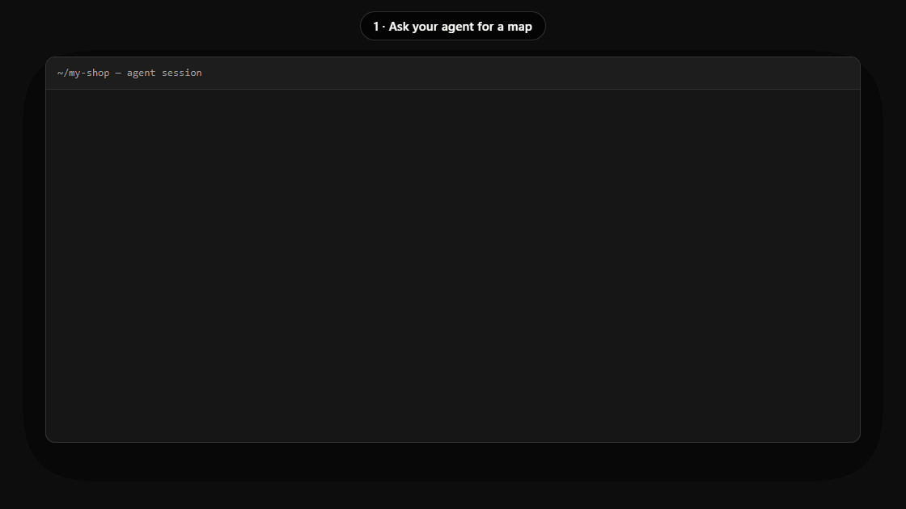
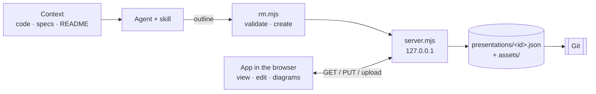
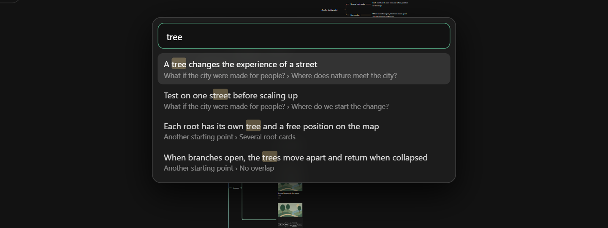
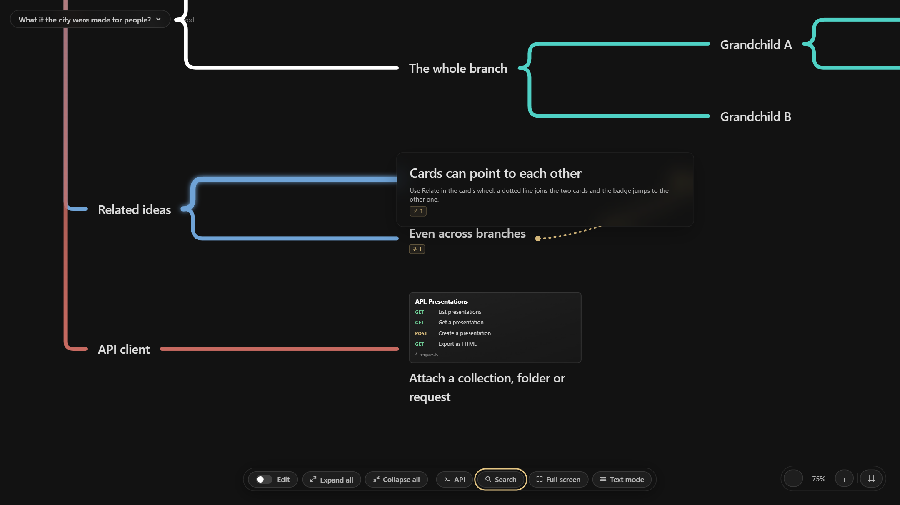
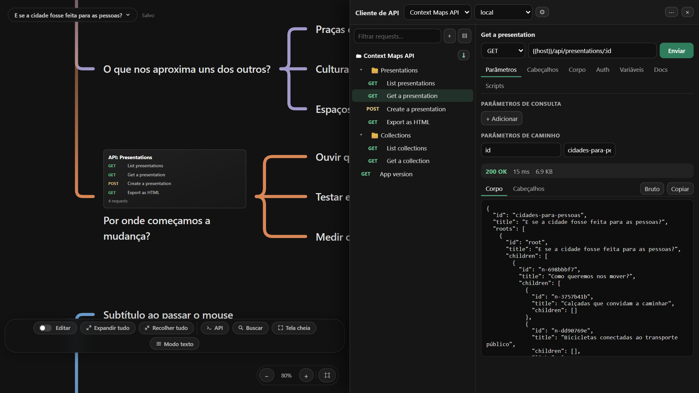
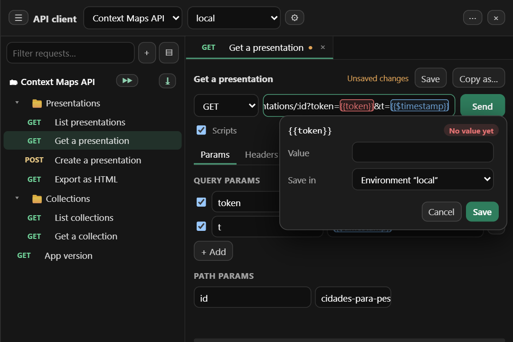
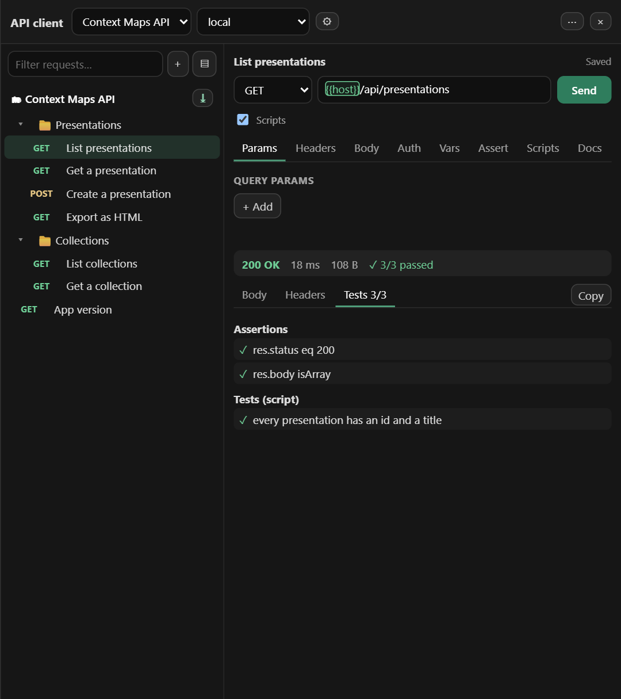
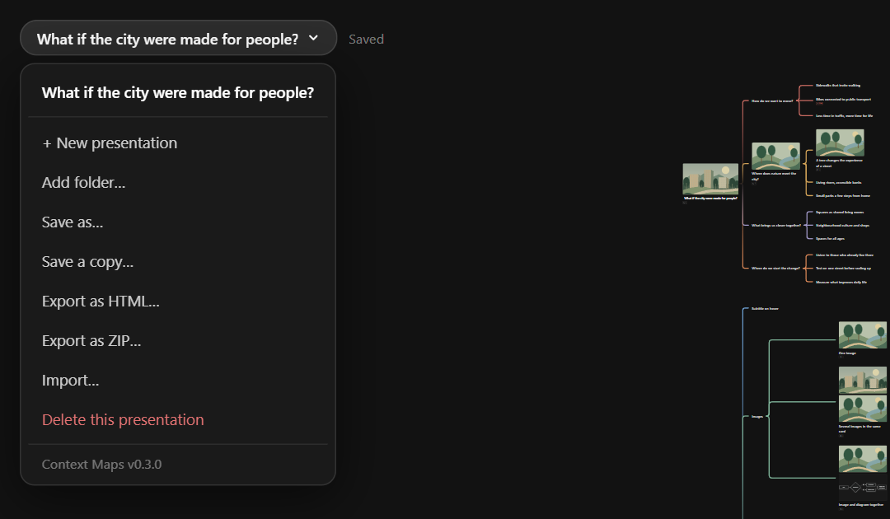

<div align="center">


<br>

[](https://github.com/p-oliveira7/context-maps/actions/workflows/ci.yml)
[](#getting-started)
[](#getting-started)
[](#security)
[](#agent-skill)
[](LICENSE)
[](#images-diagrams-and-links)

**English** · [Português (BR)](README.pt-BR.md)

[Getting started](#getting-started) · [Features](#features) · [Agent skill](#agent-skill) · [Data format](#data-format) · [API](#server-api) · [Tests](#tests) · [Changelog](CHANGELOG.md)

</div>

---

**Context Maps** is a local app to view and edit presentations as mind maps, plus an agent *skill*
(Claude, Codex, Cursor) that reads the context of an application — code, specs, flows, decisions — and
publishes the finished map with images, diagrams and links.

> No external backend, no CDN, no runtime dependencies. Everything runs on `127.0.0.1`, and every
> presentation is a JSON file you version with Git.

<p align="center">
  <br>
  <sub>From a request to a map: the skill builds it (real commands), then you explore, search and edit it.</sub>
</p>

<p align="center">
  
</p>

## Contents

- [Why Context Maps](#why-context-maps)
- [How it fits together](#how-it-fits-together)
- [Getting started](#getting-started)
- [Features](#features) — [navigate](#navigate-and-read) · [edit](#edit) · [diagrams](#images-diagrams-and-links) · [API client](#api-client-split-view) · [export](#export-import-and-share) · [save as](#save-as-and-folders)
- [Agent skill](#agent-skill)
- [Data format](#data-format) · [Server API](#server-api) · [Security](#security)
- [Tests](#tests) · [Regenerating the screenshots](#regenerating-the-screenshots)
- [Known limitations](#known-limitations) · [License](#license) · [Third-party](#third-party) · [Origin](#origin)

## Why Context Maps

Explaining a system usually needs three things that live in different places: **text** (README, specs),
**diagrams** (flows, architecture) and **evidence** (screenshots, links). A mind map brings the three onto
one navigable surface: you start from the overview and open branches as the conversation goes.

| | |
| --- | --- |
| **Versioning for free** | Each presentation is a small JSON file: `git diff` shows exactly which idea changed. |
| **No account, no cloud** | The content of your architecture never leaves your machine. |
| **Agent-friendly** | The format is small and documented ([`schema.md`](skills/context-maps/schema.md)); a CLI validates and publishes outlines. |
| **Reviewable and reproducible** | Edit by hand in the app, or ask the skill to regenerate or extend the map when the system changes. |

## How it fits together



| Piece | What it is | Where |
| --- | --- | --- |
| **App** | Map viewer and editor (HTML/CSS/ES modules) | `index.html`, `app.js`, `motion.js`, `model.js`, `store.js`, `styles.css` |
| **Local server** | Plain Node: serves the app and stores presentations | `server.mjs` |
| **Presentations** | One JSON per map + an images folder | `presentations/<id>.json`, `presentations/<id>/assets/` |
| **Skill** | Procedure + CLI for agents to build maps | `skills/context-maps/` ([guide](docs/skill.md)) |
| **Tests** | Model, browser, cards, motion, edit and skill | `tests/` |

## Getting started

Requirements: **Node 18+** (tested on Node 24). No `npm install` is needed to use the app.

```bash
node server.mjs          # or: npm start
```

Open <http://127.0.0.1:4173>. On first run the server creates the demo presentation in `presentations/`.

| Variable | Default | Purpose |
| --- | --- | --- |
| `PORT` | `4173` | Server port |
| `PRESENTATIONS_DIR` | `./presentations` | Main library folder |
| `CONTEXT_MAPS_CONFIG` | `./.context-maps.json` | Where the extra folders are remembered |
| `COLLECTIONS_DIR` | `./collections` | API client collections (Bruno format); secrets go to `.secrets/` inside it |

> Without the server (for example `python -m http.server`) the app opens in **view mode only**, with the
> built-in demo map. Do not open `index.html` through `file://` (it uses ES modules).

**Language:** the interface follows your browser's language — Portuguese (BR) or English (any other language falls back to English). Add `?lang=pt` or `?lang=en` to the URL to force one; the choice is remembered in the browser. Presentation content is yours and is never translated (the bundled example is in Portuguese).

`presentations/cities-for-people.json` ships with the repository and shows **every feature** in one
place (a Portuguese copy, `cidades-para-pessoas.json`, is included too): open it, expand everything and switch on *Edit* mode.
All the images in this README come from it, with the interface in English.

## Features

### Navigate and read

<p align="center">
  <br>
  <sub>Hovering a card highlights the line that leads to it, enlarges it a little and reveals its subtitle.</sub>
</p>

- **Pan** by dragging the background (or holding the **middle mouse button** anywhere); **scroll** to zoom; the − / + and ⌗ (fit) buttons sit in the corner.
- **Click a title** (or Enter/Space) to expand or collapse a branch. Opening animates the cards for 420 ms and highlights the connection to the first child (honours `prefers-reduced-motion`).
- **Several root cards** never overlap: when an open tree would cover another, the one that was **below (or to the right)** moves aside, so the original order is kept, and it returns to its saved position when collapsed.
- **Expand all / Collapse all**, **Full screen** and **Text mode** (linear reading of the whole map) live in the bottom bar. In **full screen** the interface gets out of the way: the presentation name and the buttons disappear and only show when the mouse nears the **top** (name and menu) or the **bottom** (buttons and zoom) of the screen, leaving a clean presentation.
- **Subtitles** show in a small panel under the card **only while hovering it**.
- **Keyboard:** Tab reaches every card; in view mode **→** opens a branch or enters it, **←** collapses or goes to the parent, **↑ ↓** move between siblings, **Enter/Space** toggle. The map is exposed to screen readers as a tree.
- **Touch:** one finger pans, **two fingers pinch to zoom** (and pan).
- **Search** (🔍 in the bottom bar, **Ctrl+K** or **/**) finds ideas by title or subtitle, ignoring case and accents; picking a result opens the branches that hide it and centres the map on it.

<p align="center">
  <br>
  <sub>Search (Ctrl+K) lists matching ideas with their path; picking one opens the branches that hide it.</sub>
</p>

<p align="center">
  <br>
  <sub>Text mode turns the map into a linear outline, handy for reading, searching and sharing.</sub>
</p>

### Images, diagrams and links

<p align="center">
  <br>
  <sub>A card can carry several images and diagrams at once, plus one or more links.</sub>
</p>

- **Images and diagrams** open full screen; with several items there are ‹ › arrows (or ← →) and a counter.
- **Links** show as a "🔗 N link(s)" badge below the card: one link opens directly, several open a list.
- **Diagrams** are [Mermaid](https://mermaid.js.org/), edited in the app with a live preview.

<p align="center">
  <br>
  <sub>The Mermaid editor: source on the left, live preview on the right.</sub>
</p>

### Edit

Turn on the **Edit** switch in the bottom bar. Hover a card and click the **✎** button at its top-centre:
a **wheel of actions** opens around it (it closes with **Esc**, ×, or by clicking outside).

<p align="center">
  
</p>

| Action | How |
| --- | --- |
| Edit text | Click the text; Enter confirms |
| Add an idea | **+ Child**, **+ Sibling** (after), **+ Before** (sibling before) or **+ Parent** (wraps the idea in a new parent card); unlimited depth |
| Root cards | **Root card** (bottom bar) adds another starting point anywhere on the map. Drag a root by its **⋮⋮** handle to place it freely. **Make root** in the wheel (or dropping any card on empty space) turns a branch into a new root |
| Presentation name | **Double-click** the name in the top-left menu to rename it (separate from the text of the root cards). Names are unique: a repeated name is refused, and *new/copy* add " (2)", " (3)"… |
| Images | **+ Image** (several files) or **drag image files onto a card**; each file is **copied** into `presentations/<id>/assets/` and the original is untouched; **×** removes one |
| Reorder media | With 2+ images/diagrams in a card: **↑ ↓** or drag the **⋮⋮** grip (a green line shows where it lands) |
| Diagrams | **+ Diagram** opens the Mermaid editor; **Edit** reopens it |
| Title-less cards | Clear the title of a card that has an image/diagram or a subtitle: it then shows only that content |
| Subtitle · Links | Type in the "Subtitle" field under the title; **+ Link** accepts http/https, with chips and **×** to remove |
| Duplicate · Copy · Paste | In the wheel: **Duplicate** clones an idea with everything below it next to the original; **Copy** keeps it, and **Paste** (shown after copying) adds it as a child of another idea — also in another presentation, copying its images |
| Relate ideas | **Relate** in the wheel, then click another idea: a dotted line joins them (both directions), a badge shows how many ideas are related and jumps to each one. Click the same pair again to remove it |
| Undo / redo | **↶ ↷** buttons in the bottom bar, or **Ctrl+Z** / **Ctrl+Shift+Z** (**Ctrl+Y**). Works for every edit, up to 100 steps; typing in one field is a single step |
| Delete | **Delete** (asks for confirmation when there are ideas below) |

**Autosave** is on (status next to the name: *Saved / Saving… / Save error*).

#### Related ideas

<p align="center">
  <br>
  <sub>A dotted line joins related ideas; hovering one highlights the line, and the badge jumps to the other idea.</sub>
</p>

#### Move ideas by dragging

<p align="center">
  
</p>

Drag the **⋮⋮ handle** on the left of a card. The card and **everything below it** leave the map and follow
the cursor as a small tree. Drop on another card (it becomes its child) or on its top/bottom edge (it becomes a
sibling). Hovering a **collapsed branch opens it by itself**, so you can walk through its sub-branches. Hold the
**middle mouse button** to pan while dragging, use the wheel to zoom, **Esc** to cancel; an **Undo** toast
follows every move.

#### Line colours

<p align="center">
  
</p>

**Colour lines** (in the wheel, on any idea with children) opens a palette. Choose **Only direct children**
(the lines leaving that card) or **The whole branch below**. The card itself, its children and the line
arriving at it never change.

### Export, import and share

- **Export as HTML…** downloads a single `.html` file with the viewer, the map and all images inside. It opens offline in any browser, read-only — send it by e-mail or attach it to a ticket.
- **Export as ZIP…** downloads the presentation files: `<name>.json` plus the `<name>/assets/` folder with its images. Unzip it into a repository folder (and **Add folder…**) or hand it to a teammate.
- **Import…** (same menu) reads a **ZIP package** or an **exported HTML file** and opens the result as a new presentation. Names stay unique (a repeated name gets " (2)"), images are copied into `presentations/<id>/assets/`, and references to files that are not in the package are dropped. Nothing in the file is executed.

### API client (split view)

<p align="center">
  <br>
  <sub>Map on the left, API client on the right: the tile on the card is a collection attached to it.</sub>
</p>

The **API** button in the bottom bar splits the screen: the map stays on the left and a **Postman/Bruno-style client** opens on the right (drag its edge, or use the arrow keys on it, to resize).

- **Collections in the Bruno format.** Each collection is a folder in `collections/` (`bruno.json`, one `.bru` file per request, folders, `environments/*.bru`). It is plain text, so it versions well with Git and opens in [Bruno](https://www.usebruno.com/). Create, import (**⋯ › Import**, a Bruno ZIP) and export (ZIP) from the panel.
- **Requests.** Method, URL (query and `:path` params stay in sync with the URL), headers, bodies (JSON, text, XML, form URL-encoded), bearer and basic auth, request variables and docs. Changes are saved automatically to the `.bru` file. **Ctrl+Enter** sends.
- **Variables and environments.** Use `{{name}}` anywhere (order: collection < environment < request variables) plus `{{$timestamp}}`, `{{$isoTimestamp}}`, `{{$guid}}` and `{{$randomInt}}`. The **Vars** tab shows the resolved request. Environments are edited with ⚙; mark a value as **Secret** and it is stored only on this machine (`collections/.secrets/`, git-ignored) — never in the `.bru` files, ZIP exports or the repository.
- **Variable colours.** In the URL, headers, params, bodies and auth fields every `{{variable}}` is highlighted: **red** when it has no value yet, **green** when it has one (blue for built-ins like `{{$timestamp}}`). **Hover** it (or press **Ctrl+.** inside it) to see the value and where it comes from, and **edit it right there**; for a variable without a value you choose where to save it: the selected environment, this request or this session only. Secret values are masked (Show reveals them), and the colours update when you change the environment.
- **Sending.** Requests go through the local server (no CORS limits; only `http`/`https`, 30 s timeout, 10 MB response). The response shows status, time, size, headers and a formatted body.
- **Scripts, tests and assertions.** The **Scripts** tab edits the pre-request script, the post-response script and `tests`; the **Assert** tab edits the declarative `assert` block (`res.status eq 200`, `res.body.items length 3`, `res.headers.content-type contains json`… 30 operators); the **Vars** tab also takes post-response variables (`token = res.body.token`). Everything is stored in the `.bru` file, so Bruno runs it too. Results appear in the **Tests** tab (pass/fail summary next to the status) and the **Console**.
- **Scripts run in an isolated sandbox.** Each script runs in a sandboxed iframe (opaque origin, CSP `default-src 'none'`) inside a Worker that is stopped after 5 s: **no network, no storage, no access to the app or its data**, so a collection you imported cannot read or leak anything. Available: `bru` (`getVar`/`setVar`, `getEnvVar`/`setEnvVar`, `interpolate`, `sleep`…), `req` (`getUrl`/`setUrl`, `setHeader`, `setBody`…), `res` (`res.status`, `res.body`, `res('path')`…), `test`, `expect` (Chai-style) and `require("chai")`. A pre-request script runs before `{{variables}}` are resolved, so `bru.setVar` can feed the same request. Not available: `bru.sendRequest`/`runRequest`, `axios`, `lodash` and other modules. The **Scripts** switch next to Send turns script execution off.
- **Reorder** requests and folders by dragging them in the tree.

<p align="center">
  
  <br>
  <sub>Left: <code>{{variables}}</code> are red without a value and green with one; hover to see and edit the value. Right: assertions and script tests in the response.</sub>
</p>

**Attach to a card.** Drag a collection, a folder or a single request from the panel onto a card (edit mode), or open the card's wheel, choose **API** and press ⤓ on one of them. The card shows a tile, like an image, with the first requests. Clicking it opens the client **without changing the map's zoom or focus**, expands only the attached folder (or the folder of the attached request, selecting the request) and flashes the target row. The tile keeps a saved snapshot, so it still reads in text mode and in exported HTML (where it is not clickable, since there is no server).

An example collection, **Context Maps API**, ships in `collections/` and documents the app's own API (choose the `local` environment).

<p align="center">
  <br>
  <sub>The presentation menu: save, export (HTML or ZIP) and import.</sub>
</p>

### Save as and folders

<p align="center">
  
</p>

**Save as…** and **Save a copy…** (in the presentation menu, or **Ctrl+Shift+S**) open a window where you
choose the **name**, the **folder** and what happens next:

- **Folder:** the app library (`presentations/`), any folder you registered before, or **Other folder…** — type a full path or press **Choose…** (a native folder window opens). The folder is created if needed, remembered in `.context-maps.json` (not versioned) and listed in the menu, so you can **open and edit presentations in place**, e.g. inside another project's repository. **Add folder…** registers a folder that already has presentations; the **×** beside a folder only removes it from the list (no file is deleted).
- **After saving:** *Open the new presentation* (default for *Save as*) or *Keep working on this one* (default for *Save a copy*). The file and its images are copied together; names stay unique.
- In extra folders, image paths are stored **relative to the file** (`<name>/assets/…`), so the whole folder is portable.

## Agent skill

The skill turns context into a map. Flow summary (details in [`docs/skill.md`](docs/skill.md)):

1. The agent makes sure the server is up: `node skills/context-maps/scripts/rm.mjs serve`.
2. It reads the relevant context (code, README, specs, existing diagrams).
3. It writes a markdown **outline**:

   ```markdown
   # Login flow [img:docs/cover.png|Cover]
   - Authenticate {color=#c76a61}
     - Validate credentials [link:https://owasp.org/|OWASP]
     - Detailed flow [mermaid:docs/login.mmd]
   - Session
     - Refresh token
   ```
4. It validates and publishes:

   ```bash
   node skills/context-maps/scripts/rm.mjs validate --outline map.md
   node skills/context-maps/scripts/rm.mjs create   --outline map.md --id login-flow
   ```
5. It gets the URL (`http://127.0.0.1:4173/?p=login-flow`), the generated file and a report (nodes, media, skipped items).

Example requests: *"map this repository's architecture"*, *"map the payment flows using the diagrams in
`docs/`"*, *"turn this specification into a map for tomorrow's meeting"*.

**Outline cheat sheet**

| Marker | Effect |
| --- | --- |
| `# Title` | A root card (several `#` lines make several roots) |
| `- Title` (indented) | A child card; indentation sets the depth |
| `[img:path\|alt]` | Attach a local image |
| `[mermaid:file.mmd]` | Render a Mermaid file as a diagram (needs `mmdc`) |
| `[link:url\|label]` | Add a link |
| `[subtitle:text]` | Supporting text shown on hover |
| `[rel:Idea title]` | Relates this idea to another one (cross-link) by its exact title |
| `{color=#hex}` · `{links=#hex}` | Card colour · colour of the lines leaving the card |

CLI options: `--id`, `--title`, `--replace`, `--dir <folder>` (create in another folder). To refresh a map after the system changed, run `update --id <slug> --outline map.md`: it matches ideas by title and keeps ids, colours, positions and manual edits (`--dry-run` previews, `--prune` removes ideas missing from the outline). Messages follow
`RM_LANG=en|pt`; `MMDC` / `MMDC_BROWSER` point to mermaid-cli and its browser.

### Agent compatibility

| Agent | How the skill is found | Status |
| --- | --- | --- |
| **Claude (Claude Code)** | `skills/context-maps/SKILL.md` (copy to `~/.claude/skills/` for global use) | Native format |
| **Codex** | `AGENTS.md` at the root points to `SKILL.md` | Files checked in CI; real-app run pending ([how to verify](docs/skill.md#codex-and-cursor)) |
| **Cursor** | `.cursor/rules/context-maps.mdc` and `AGENTS.md` | Files checked in CI; real-app run pending ([how to verify](docs/skill.md#codex-and-cursor)) |

The heavy lifting lives in a Node CLI (`rm.mjs`), so any agent with terminal access can use it. Agent-facing
instructions (`SKILL.md`, `schema.md`, `AGENTS.md`) are in English, with Portuguese copies (`*.pt-BR.md`).

## Data format

```json
{
  "id": "my-flow",
  "title": "Presentation name",
  "roots": [{
    "id": "root",
    "title": "First root card",
    "x": 0, "y": 0,
    "children": [
      {
        "id": "n-1a2b3c4d",
        "title": "Idea",
        "color": "#c76a61",
        "linksColor": "#ffffff",
        "subtitle": "Supporting text shown on hover",
        "images": [
          {"src": "presentations/my-flow/assets/screen.png", "alt": "Home screen"},
          {"src": "presentations/my-flow/assets/d.svg", "alt": "Diagram", "kind": "diagram", "source": "flowchart TD…"}
        ],
        "links": [{"url": "https://example.com/docs", "label": "Docs"}],
        "related": ["n-9f8e7d6c"],
        "children": []
      }
    ]
  }]
}
```

Full reference and modelling best practices: [`skills/context-maps/schema.md`](skills/context-maps/schema.md).
The older `{id, tree}` form is still read and migrated on save.

## Server API

Listens on `127.0.0.1` only. Every route answers JSON with `Cache-Control: no-store`.

| Method and route | Purpose |
| --- | --- |
| `GET /api/presentations` | List (`id`, `title`, `updatedAt`) |
| `POST /api/presentations` | Create (`{title, id?, dir?}`; `dir` = any absolute folder) |
| `GET /api/presentations/:id` | Read |
| `PUT /api/presentations/:id` | Save `{title, roots}` (validates unique ids, depth ≤ 40, ≤ 50 media/links per node) |
| `POST /api/presentations/:id/copy` | Copy under a new name (`{title, dir?}`), including images, into the library or another folder |
| `GET/POST /api/libraries`, `DELETE /api/libraries/:key` | List, add or forget extra folders |
| `POST /api/pick-folder` | Opens the system folder picker and returns the chosen path |
| `GET /api/presentations/:id/export?format=html\|zip` | Download the presentation as one self-contained HTML file or as a ZIP package |
| `GET/POST/DELETE /api/collections…` | Collections in the Bruno format: list, create, items, requests, environments, ZIP export/import (`/api/collections/import`) |
| `POST /api/send` | Send an HTTP request from the local server (`http`/`https` only) for the API client |
| `POST /api/import?name=…` | Import a ZIP package or an exported HTML file (raw body) as a new presentation |
| `DELETE /api/presentations/:id` | Remove the file and its images |
| `POST /api/presentations/:id/assets?name=…` | Upload an image (png, jpg, webp, gif, svg; up to 15 MB) |

### Security

Every request that changes something must carry the `x-context-maps: 1` header (other web pages cannot send
it to your local server) and the `Host` must be local. There is no access to files outside the app folder and
the registered libraries, only http/https links are accepted, and Mermaid runs with `securityLevel: strict`. `POST /api/send` (the API client proxy) is protected the same way, but note that it can reach any host your machine can — including `localhost` services — so use the app only on a machine and network you trust. Collection scripts, in contrast, run in a no-network sandbox (see above).

## Tests

`npm test` runs the model tests (Node, no setup). The browser tests use Playwright and an installed Chrome:

```bash
npm install --no-save playwright-core   # once; or set PLAYWRIGHT_MODULE to an existing playwright-core
npm run test:e2e                        # edit, skill, collections, sandbox, api, browser, cards, motion and a11y, with an isolated temporary server
node tests/edit.mjs                     # or run a single suite
```

| Suite | Covers |
| --- | --- |
| `edit` EDIT-01..31 | editing, diagrams, media, links, folders, language, export, import |
| `skill` SKILL-01..09 | skill CLI |
| `browser` MAP-01..12 | navigation, zoom, text mode, mobile, full screen |
| `cards` CARD-01..06 | titles, root, keyboard, images |
| `motion` MOT-01..05 | animations and reduced motion |
| `sandbox` SBX-01..05 · `scripting` SCR-01..07 | script sandbox (no network, timeouts), expect, asserts, request pipeline |
| `collections` COLL-01..06 · `bru` BRU-01..05 | Bruno format, collections API, secrets, ZIP |
| `api` API-01..13 | split-view client, environments, sending, attaching to cards |
| `a11y` A11Y-01..07 | tree semantics, keyboard navigation, accessible names, dialog focus, pinch zoom |

`BROWSER_EXECUTABLE` selects a specific Chrome/Chromium binary. The same checks run on Linux, macOS and Windows
for every pull request ([`.github/workflows/ci.yml`](.github/workflows/ci.yml)). To run `browser`, `cards` or
`motion` on their own, point `PREVIEW_URL` (default `http://127.0.0.1:4173`) at a server with an empty or temporary `PRESENTATIONS_DIR`.

### Regenerating the screenshots and the demo

The images in `docs/images/` come from the English example presentation (`presentations/cities-for-people.json`, itself generated from the Portuguese one by `docs/build-example-en.mjs`) and are reproducible. The script copies
`presentations/` to a temporary folder, so your files are not touched:

```bash
PLAYWRIGHT_MODULE=file:///path/to/playwright-core/index.mjs node docs/screenshots.mjs   # the PNGs
PLAYWRIGHT_MODULE=file:///path/to/playwright-core/index.mjs node docs/demo.mjs          # demo.gif (real skill commands on a temporary server)
```

`docs/demo.mjs` records the frames with Playwright and encodes the GIF with `docs/gif.mjs`, a small dependency-free encoder.

## Known limitations

- The structure is a **tree**; ideas can be **related** across branches (dotted lines), but there are no arrows or labels on those relations.
- **CLI diagrams** need `mmdc` (mermaid-cli); in the app editor Mermaid is already bundled.
- Remote image URLs are **not downloaded** by the skill (use local files).
- Removing a media item does not delete its file from `assets/`.
- Designed for a **local machine, single user**: there is no authentication or simultaneous editing.

## License

[MIT](LICENSE) © 2026 Paulo Oliveira.

## Third-party

`vendor/mermaid.min.js` — [Mermaid](https://github.com/mermaid-js/mermaid) 12.2.0, MIT licence
(`vendor/mermaid.LICENSE`). Loaded on demand by the diagram editor only.

## Origin

The viewer's behaviour was inspired by observing a public mind-map viewer. The content, illustrations,
code and texts in this repository are original; nothing from the reference was copied.
