<div align="center">

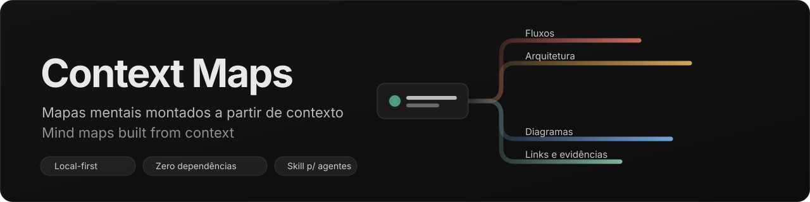

<br>

[](https://github.com/p-oliveira7/context-maps/actions/workflows/ci.yml)
[](#começando)
[](#começando)
[](#segurança)
[](#skill-para-agentes)
[](LICENSE)
[](#imagens-diagramas-e-links)

**Português (BR)** · [English](README.md)

[Começando](#começando) · [Recursos](#recursos) · [Skill](#skill-para-agentes) · [Formato](#formato-dos-dados) · [API](#api-do-servidor) · [Testes](#testes) · [Changelog](CHANGELOG.md)

</div>

---

**Context Maps** é um app local para visualizar e editar apresentações em formato de mapa mental, mais uma
*skill* para agentes (Claude, Codex, Cursor) que lê o contexto de uma aplicação — código, specs, fluxos,
decisões — e publica o mapa pronto, com imagens, diagramas e links.

> Sem backend externo, sem CDN, sem dependências de runtime. Tudo roda em `127.0.0.1` e cada
> apresentação é um arquivo JSON que você versiona com Git.

<p align="center">
  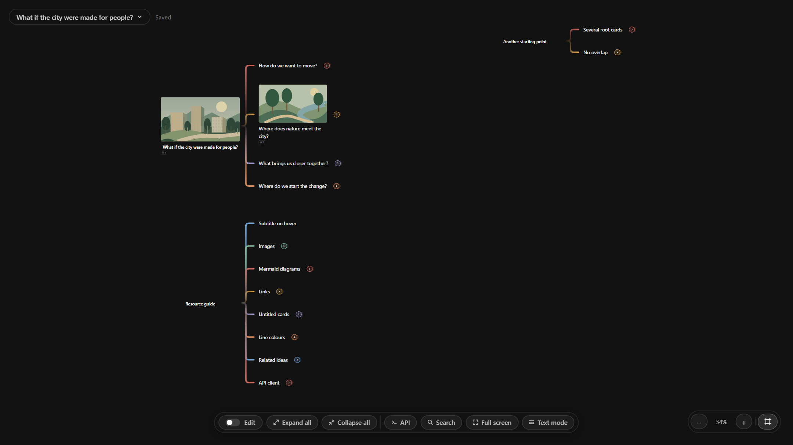
</p>

## Sumário

- [Por que Context Maps](#por-que-context-maps)
- [Como as peças se encaixam](#como-as-peças-se-encaixam)
- [Começando](#começando)
- [Recursos](#recursos) — [navegar](#navegar-e-ler) · [editar](#editar) · [diagramas](#imagens-diagramas-e-links) · [exportar](#exportar-importar-e-compartilhar) · [salvar como](#salvar-como-e-pastas)
- [Skill para agentes](#skill-para-agentes)
- [Formato dos dados](#formato-dos-dados) · [API do servidor](#api-do-servidor) · [Segurança](#segurança)
- [Testes](#testes) · [Regenerando as imagens](#regenerando-as-imagens)
- [Limitações conhecidas](#limitações-conhecidas) · [Licença](#licença) · [Terceiros](#terceiros) · [Origem](#origem)

## Por que Context Maps

Explicar um sistema costuma exigir três coisas que vivem em lugares diferentes: **o texto** (README,
specs), **os diagramas** (fluxos, arquitetura) e **as evidências** (prints, links). Um mapa mental junta
as três numa só superfície navegável: você começa pela visão geral e abre os ramos conforme a conversa.

| | |
| --- | --- |
| **Versionamento de graça** | Cada apresentação é um JSON pequeno: `git diff` mostra exatamente que ideia mudou. |
| **Sem conta, sem nuvem** | O conteúdo da sua arquitetura não sai da sua máquina. |
| **Legível por agentes** | O formato é pequeno e documentado ([`schema.md`](skills/context-maps/schema.md)); um CLI valida e publica outlines. |
| **Revisável e reproduzível** | Edite à mão no app ou peça à skill para regerar ou ampliar o mapa quando o sistema mudar. |

## Como as peças se encaixam

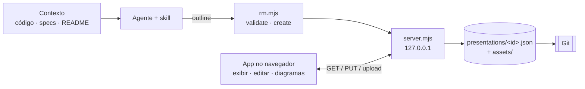

| Peça | O que é | Onde |
| --- | --- | --- |
| **App** | Visualizador e editor de mapas (HTML/CSS/ES modules) | `index.html`, `app.js`, `motion.js`, `model.js`, `store.js`, `styles.css` |
| **Servidor local** | Node sem pacotes: serve o app e grava as apresentações | `server.mjs` |
| **Apresentações** | Um JSON por mapa + pasta de imagens | `presentations/<id>.json`, `presentations/<id>/assets/` |
| **Skill** | Procedimento + CLI para agentes montarem mapas | `skills/context-maps/` ([guia](docs/skill.pt-BR.md)) |
| **Testes** | Modelo, navegador, cards, movimento, edição e skill | `tests/` |

## Começando

Requisitos: **Node 18+** (testado em Node 24). Nenhum `npm install` é necessário para usar o app.

```bash
node server.mjs          # ou: npm start
```

Abra <http://127.0.0.1:4173>. Na primeira execução o servidor cria a apresentação de demonstração em `presentations/`.

| Variável | Padrão | Uso |
| --- | --- | --- |
| `PORT` | `4173` | Porta do servidor |
| `PRESENTATIONS_DIR` | `./presentations` | Pasta da biblioteca principal |
| `CONTEXT_MAPS_CONFIG` | `./.context-maps.json` | Onde as pastas extras ficam registradas |

> Sem o servidor (por exemplo `python -m http.server`), o app abre **somente em exibição**, com o mapa
> de demonstração embutido. Não abra o `index.html` por `file://` (usa módulos ES).

**Idioma:** a interface segue o idioma do navegador — português (BR) ou inglês (qualquer outro idioma cai no inglês). Acrescente `?lang=pt` ou `?lang=en` à URL para forçar um deles; a escolha fica guardada no navegador. O conteúdo das apresentações é seu e nunca é traduzido (o exemplo que acompanha o projeto está em português).

`presentations/cidades-para-pessoas.json` acompanha o repositório e mostra **todos os recursos** num só
lugar: abra, expanda tudo e ligue o modo *Editar*.

## Recursos

### Navegar e ler

<p align="center">
  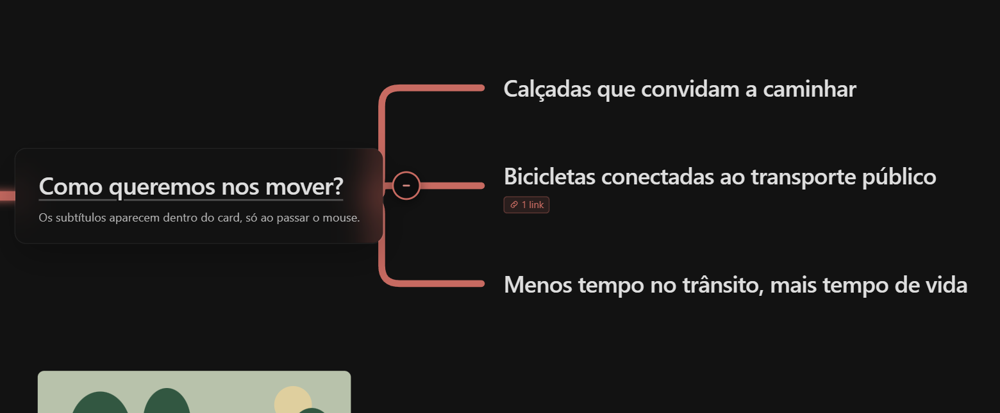<br>
  <sub>Passar o mouse num card destaca a linha que chega até ele, o aumenta um pouco e revela o subtítulo.</sub>
</p>

- **Mover** arrastando o fundo (ou segurando o **botão do meio do mouse** em qualquer lugar); **rolar** dá zoom; os botões − / + e ⌗ (enquadrar) ficam no canto.
- **Clique no título** (ou Enter/Espaço) expande ou recolhe um ramo. Abrir anima os cards por 420 ms e destaca a conexão ao primeiro filho (respeita `prefers-reduced-motion`).
- **Vários cards raiz** nunca se sobrepõem: quando uma árvore aberta cobriria outra, quem estava **abaixo (ou à direita)** se afasta, então a ordem original é mantida, e volta à posição salva ao recolher.
- **Expandir tudo / Recolher tudo**, **Tela cheia** e **Modo texto** (leitura linear do mapa inteiro) ficam na barra inferior.
- **Subtítulos** aparecem num pequeno painel sob o card **somente ao passar o mouse**.

<p align="center">
  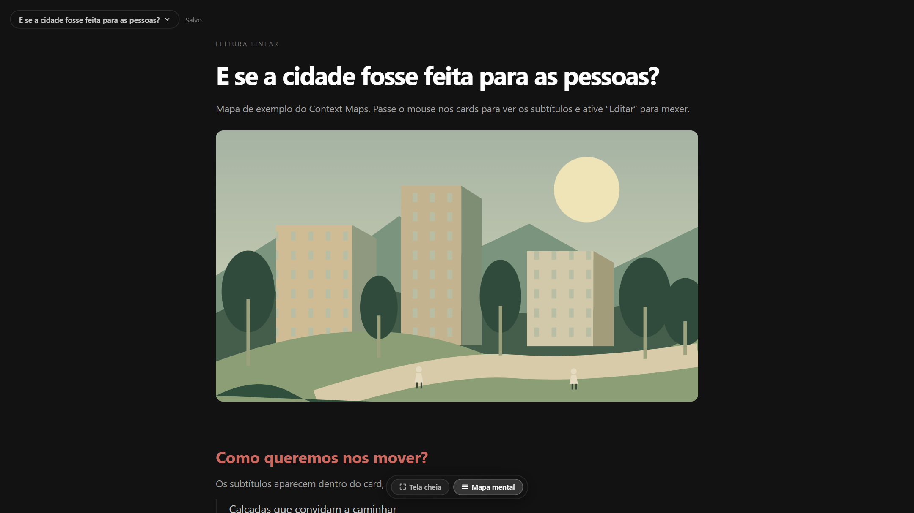<br>
  <sub>O modo texto transforma o mapa num roteiro linear, bom para ler, buscar e compartilhar.</sub>
</p>

### Imagens, diagramas e links

<p align="center">
  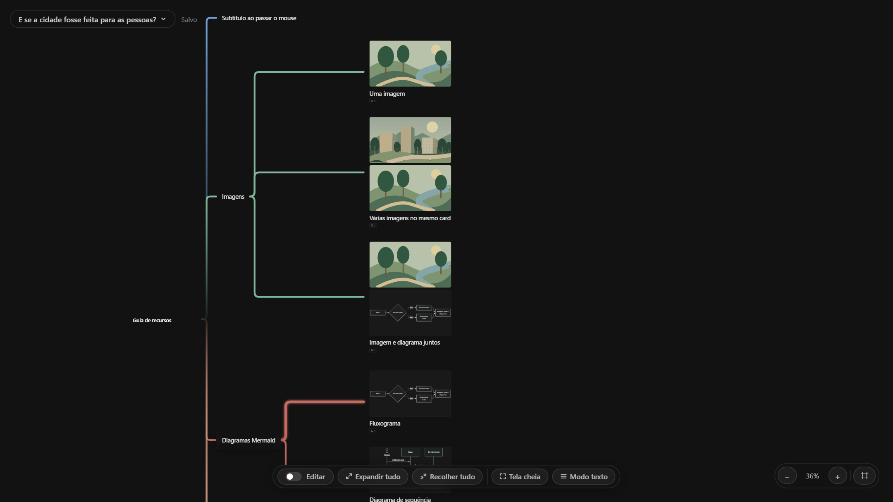<br>
  <sub>Um card pode ter várias imagens e diagramas ao mesmo tempo, além de um ou mais links.</sub>
</p>

- **Imagens e diagramas** abrem em tela cheia; com várias mídias há setas ‹ › (ou ← →) e contador.
- **Links** aparecem como selo "🔗 N link(s)" abaixo do card: um link abre direto, vários abrem uma lista.
- **Diagramas** são [Mermaid](https://mermaid.js.org/), editados no app com pré-visualização ao vivo.

<p align="center">
  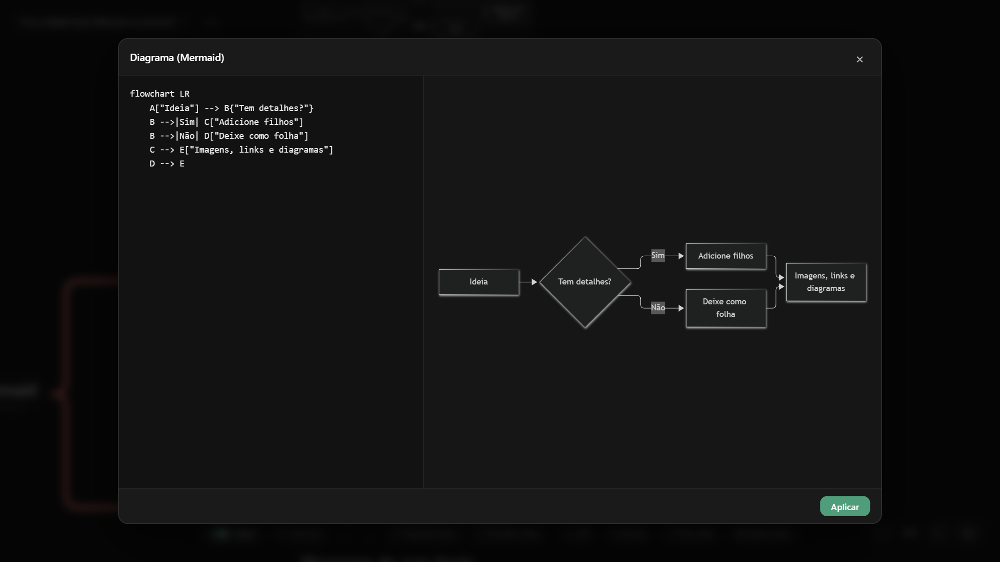<br>
  <sub>O editor Mermaid: código à esquerda, pré-visualização ao vivo à direita.</sub>
</p>

### Editar

Ative o switch **Editar** na barra inferior. Passe o mouse num card e clique no botão **✎** no topo, ao
centro: abre uma **roda de ações** em volta dele (fecha com **Esc**, × ou clicando fora).

<p align="center">
  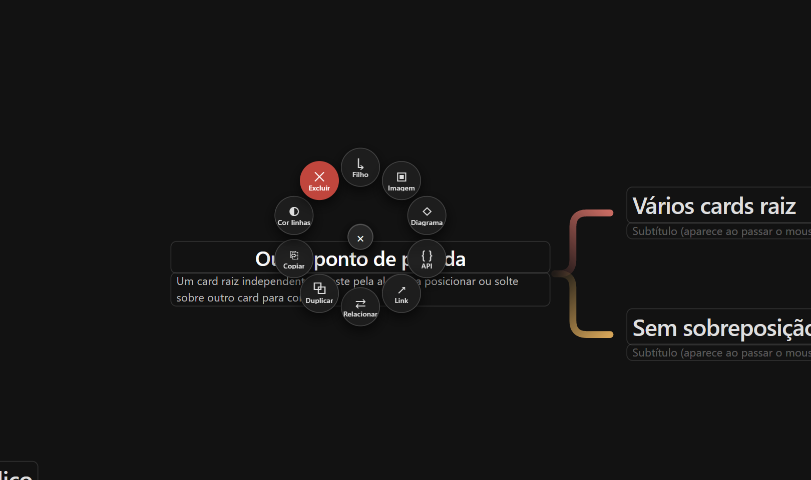
</p>

| Ação | Como |
| --- | --- |
| Editar texto | Clique no texto; Enter confirma |
| Adicionar ideia | **+ Filho**, **+ Irmão** (depois), **+ Antes** (irmão antes) ou **+ Pai** (envolve a ideia num novo card pai); profundidade livre |
| Cards raiz | **Card raiz** (barra inferior) adiciona outro ponto de partida em qualquer lugar do mapa. Arraste uma raiz pela alça **⋮⋮** para posicioná-la livremente. **Virar raiz** na roda (ou soltar qualquer card no espaço vazio) transforma um ramo numa nova raiz |
| Nome da apresentação | **Duplo clique** no nome, no menu do canto superior esquerdo, para renomear (separado do texto dos cards raiz). Os nomes são únicos: um nome repetido é recusado, e *nova/cópia* acrescentam " (2)", " (3)"… |
| Imagens | **+ Imagem** (vários arquivos) ou **arraste arquivos de imagem para o card**; cada arquivo é **copiado** para `presentations/<id>/assets/` e o original não é alterado; **×** remove uma |
| Reordenar mídias | Com 2+ imagens/diagramas no card: **↑ ↓** ou arraste a alça **⋮⋮** (uma linha verde mostra onde cai) |
| Diagramas | **+ Diagrama** abre o editor Mermaid; **Editar** reabre |
| Cards sem título | Apague o título de um card que tenha imagem/diagrama ou subtítulo: ele passa a mostrar só esse conteúdo |
| Subtítulo · Links | Digite no campo "Subtítulo" abaixo do título; **+ Link** aceita http/https, com chips e **×** para remover |
| Excluir | **Excluir** (pede confirmação se houver ideias abaixo) |

O **salvamento é automático** (o estado aparece ao lado do nome: *Salvo / Salvando… / Erro ao salvar*).

#### Mover ideias arrastando

<p align="center">
  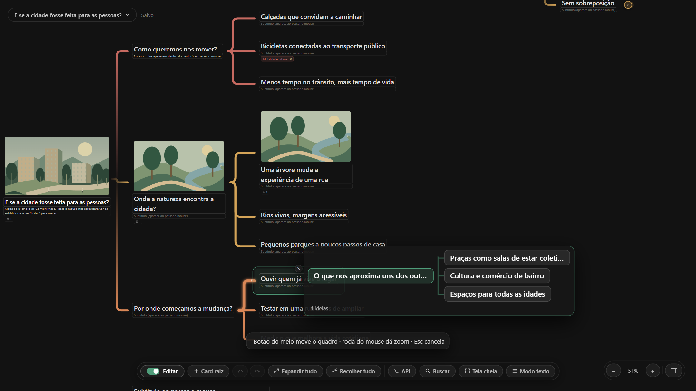
</p>

Arraste a **alça ⋮⋮** à esquerda do card. O card e **tudo abaixo dele** saem do mapa e acompanham o cursor
como uma pequena árvore. Solte sobre outro card (vira filho) ou na borda de cima/baixo (vira irmão). Pairar
sobre um **ramo fechado o abre sozinho**, para você percorrer as ramificações. Segure o **botão do meio do
mouse** para mover o quadro durante o arraste, a roda dá zoom e **Esc** cancela; depois de cada movimento
aparece **Desfazer**.

#### Cor das ligações

<p align="center">
  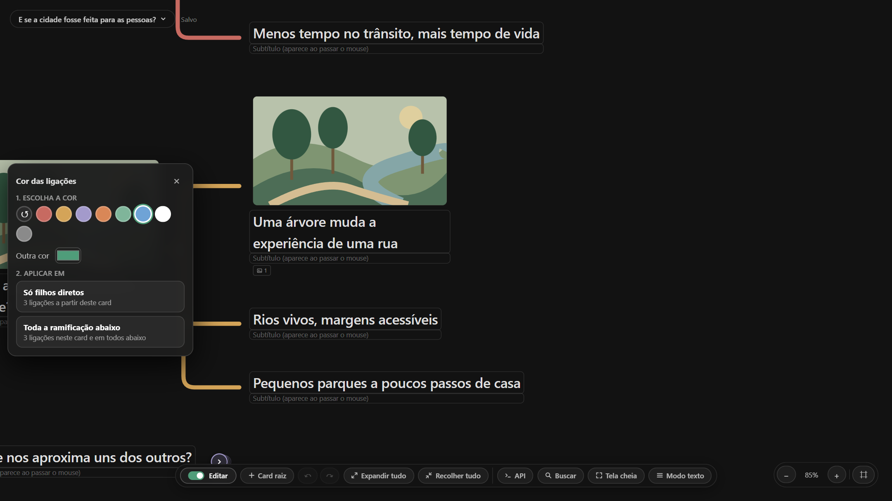
</p>

**Cor linhas** (na roda, em qualquer ideia com filhas) abre uma paleta. Escolha **Só filhos diretos** (as
linhas que saem daquele card) ou **Toda a ramificação abaixo**. O próprio card, as filhas e a linha que
chega até ele nunca mudam.

### Exportar, importar e compartilhar

- **Exportar como HTML…** baixa um único arquivo `.html` com o visualizador, o mapa e todas as imagens dentro. Ele abre offline em qualquer navegador, somente leitura — dá para mandar por e-mail ou anexar a um chamado.
- **Exportar como ZIP…** baixa os arquivos da apresentação: `<nome>.json` mais a pasta `<nome>/assets/` com as imagens. Descompacte numa pasta de um repositório (e use **Adicionar pasta…**) ou entregue a um colega.
- **Importar…** (no mesmo menu) lê um **pacote ZIP** ou um **HTML exportado** e abre o resultado como uma apresentação nova. Os nomes continuam únicos (um nome repetido ganha " (2)"), as imagens são copiadas para `presentations/<id>/assets/` e referências a arquivos que não estão no pacote são descartadas. Nada do arquivo é executado.

### Salvar como e pastas

<p align="center">
  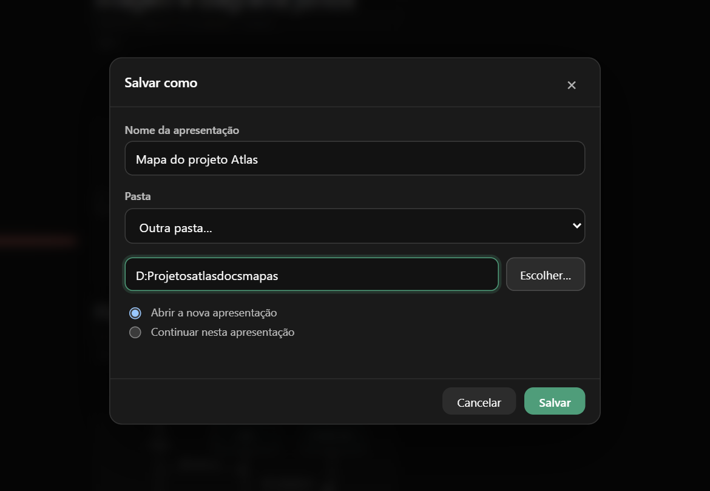
</p>

**Salvar como…** e **Salvar uma cópia…** (no menu de apresentações, ou **Ctrl+Shift+S**) abrem uma janela
onde você escolhe o **nome**, a **pasta** e o que acontece depois:

- **Pasta:** a biblioteca do app (`presentations/`), qualquer pasta registrada antes, ou **Outra pasta…** — digite o caminho completo ou clique em **Escolher…** (abre a janela nativa de pastas). A pasta é criada se preciso, lembrada em `.context-maps.json` (não versionado) e listada no menu, então você pode **abrir e editar apresentações no próprio lugar**, por exemplo dentro do repositório de outro projeto. **Adicionar pasta…** registra uma pasta que já tem apresentações; o **×** ao lado da pasta só a tira da lista (nenhum arquivo é apagado).
- **Depois de salvar:** *Abrir a nova apresentação* (padrão do *Salvar como*) ou *Continuar nesta* (padrão do *Salvar uma cópia*). O arquivo e as imagens são copiados juntos; os nomes continuam únicos.
- Em pastas extras, os caminhos das imagens são gravados **relativos ao arquivo** (`<nome>/assets/…`), então a pasta inteira é portátil.

## Skill para agentes

A skill transforma contexto em mapa. Resumo do fluxo (detalhes em [`docs/skill.pt-BR.md`](docs/skill.pt-BR.md)):

1. O agente garante o servidor: `node skills/context-maps/scripts/rm.mjs serve`.
2. Lê o contexto relevante (código, README, specs, diagramas existentes).
3. Escreve um **outline** em markdown:

   ```markdown
   # Fluxo de login [img:docs/capa.png|Capa]
   - Autenticar {color=#c76a61}
     - Validar credenciais [link:https://owasp.org/|OWASP]
     - Fluxo detalhado [mermaid:docs/login.mmd]
   - Sessão
     - Renovar token
   ```
4. Valida e publica:

   ```bash
   node skills/context-maps/scripts/rm.mjs validate --outline mapa.md
   node skills/context-maps/scripts/rm.mjs create   --outline mapa.md --id fluxo-login
   ```
5. Recebe a URL (`http://127.0.0.1:4173/?p=fluxo-login`), o arquivo gerado e um relatório (nós, mídias, itens pulados).

Exemplos de pedidos: *"mapa da arquitetura deste repositório"*, *"mapa dos fluxos de pagamento com os
diagramas do `docs/`"*, *"transforme esta especificação em um mapa para a reunião de amanhã"*.

**Cola rápida do outline**

| Marcador | Efeito |
| --- | --- |
| `# Título` | Um card raiz (várias linhas `#` criam várias raízes) |
| `- Título` (indentado) | Um card filho; a indentação define a profundidade |
| `[img:caminho\|alt]` | Anexa uma imagem local |
| `[mermaid:arquivo.mmd]` | Renderiza um arquivo Mermaid como diagrama (exige `mmdc`) |
| `[link:url\|rótulo]` | Adiciona um link |
| `[subtitle:texto]` | Texto de apoio exibido ao passar o mouse |
| `{color=#hex}` · `{links=#hex}` | Cor do card · cor das linhas que saem do card |

Opções do CLI: `--id`, `--title`, `--replace`, `--dir <pasta>` (cria em outra pasta). As mensagens seguem
`RM_LANG=en|pt`; `MMDC` / `MMDC_BROWSER` apontam para o mermaid-cli e seu navegador.

### Compatibilidade com agentes

| Agente | Como a skill é encontrada | Status |
| --- | --- | --- |
| **Claude (Claude Code)** | `skills/context-maps/SKILL.md` (copie para `~/.claude/skills/` para uso global) | Formato nativo |
| **Codex** | `AGENTS.md` na raiz aponta para o `SKILL.md` | Preparado; não testado |
| **Cursor** | `.cursor/rules/context-maps.mdc` e `AGENTS.md` | Preparado; não testado |

O trabalho pesado fica em um CLI Node (`rm.mjs`), então qualquer agente com acesso ao terminal consegue usar.
As instruções para agentes (`SKILL.md`, `schema.md`, `AGENTS.md`) estão em inglês, com cópias em português (`*.pt-BR.md`).

## Formato dos dados

```json
{
  "id": "meu-fluxo",
  "title": "Nome da apresentação",
  "roots": [{
    "id": "root",
    "title": "Primeiro card raiz",
    "x": 0, "y": 0,
    "children": [
      {
        "id": "n-1a2b3c4d",
        "title": "Ideia",
        "color": "#c76a61",
        "linksColor": "#ffffff",
        "subtitle": "Texto de apoio exibido ao passar o mouse",
        "images": [
          {"src": "presentations/meu-fluxo/assets/tela.png", "alt": "Tela inicial"},
          {"src": "presentations/meu-fluxo/assets/d.svg", "alt": "Diagrama", "kind": "diagram", "source": "flowchart TD…"}
        ],
        "links": [{"url": "https://exemplo.com/docs", "label": "Docs"}],
        "children": []
      }
    ]
  }]
}
```

Referência completa e boas práticas de modelagem: [`skills/context-maps/schema.pt-BR.md`](skills/context-maps/schema.pt-BR.md).
O formato antigo `{id, tree}` ainda é lido e migrado ao salvar.

## API do servidor

Escuta apenas em `127.0.0.1`. Todas as rotas respondem JSON e `Cache-Control: no-store`.

| Método e rota | Função |
| --- | --- |
| `GET /api/presentations` | Lista (`id`, `title`, `updatedAt`) |
| `POST /api/presentations` | Cria (`{title, id?, dir?}`; `dir` = qualquer pasta absoluta) |
| `GET /api/presentations/:id` | Lê |
| `PUT /api/presentations/:id` | Salva `{title, roots}` (valida ids únicos, profundidade ≤ 40, mídias/links ≤ 50 por nó) |
| `POST /api/presentations/:id/copy` | Copia com um novo nome (`{title, dir?}`), incluindo as imagens, para a biblioteca ou outra pasta |
| `GET/POST /api/libraries`, `DELETE /api/libraries/:key` | Lista, adiciona ou esquece pastas extras |
| `POST /api/pick-folder` | Abre o seletor de pastas do sistema e devolve o caminho escolhido |
| `GET /api/presentations/:id/export?format=html\|zip` | Baixa a apresentação como um HTML único e autocontido ou como pacote ZIP |
| `POST /api/import?name=…` | Importa um pacote ZIP ou um HTML exportado (corpo bruto) como uma apresentação nova |
| `DELETE /api/presentations/:id` | Remove o arquivo e as imagens |
| `POST /api/presentations/:id/assets?name=…` | Envia imagem (png, jpg, webp, gif, svg; até 15 MB) |

### Segurança

Toda requisição que altera algo precisa do cabeçalho `x-context-maps: 1` (outras páginas web não conseguem
enviá-lo ao seu servidor local) e o `Host` precisa ser local. Não há acesso a arquivos fora da pasta do app e
das bibliotecas registradas, só links http/https são aceitos e o Mermaid roda em `securityLevel: strict`.

## Testes

`npm test` roda os testes de modelo (Node, sem preparação). Os testes de navegador usam Playwright e o Chrome instalado:

```bash
npm install --no-save playwright-core   # uma vez; ou defina PLAYWRIGHT_MODULE para um playwright-core existente
npm run test:e2e                        # edit, skill, browser, cards e motion, com servidor temporário isolado
node tests/edit.mjs                     # ou rode uma suíte só
```

| Suíte | Cobre |
| --- | --- |
| `edit` EDIT-01..28 | edição, diagramas, mídias, links, pastas, idioma, exportação, importação |
| `skill` SKILL-01..07 | CLI da skill |
| `browser` MAP-01..11 | navegação, zoom, modo texto, mobile, tela cheia |
| `cards` CARD-01..06 | títulos, raiz, teclado, imagens |
| `motion` MOT-01..05 | animações e movimento reduzido |

`BROWSER_EXECUTABLE` escolhe um binário específico do Chrome/Chromium. As mesmas verificações rodam em Linux,
macOS e Windows a cada pull request ([`.github/workflows/ci.yml`](.github/workflows/ci.yml)). Para rodar `browser`,
`cards` ou `motion` isoladamente, aponte `PREVIEW_URL` (padrão `http://127.0.0.1:4173`) para um servidor com `PRESENTATIONS_DIR` vazio ou temporário.

### Regenerando as imagens

As imagens em `docs/images/` vêm da apresentação de exemplo e são reproduzíveis. O script copia
`presentations/` para uma pasta temporária, então seus arquivos não são tocados:

```bash
PLAYWRIGHT_MODULE=file:///caminho/para/playwright-core/index.mjs node docs/screenshots.mjs
```

## Limitações conhecidas

- **Sem ligações cruzadas** entre ideias (a estrutura é uma árvore). Ciclos viram texto ou diagrama.
- **Diagramas via CLI** exigem `mmdc` (mermaid-cli); no editor do app o Mermaid já vem embutido.
- URLs remotas de imagem **não são baixadas** pela skill (use arquivos locais).
- Mobile: arrastar com um dedo e botões de zoom; pinch não implementado.
- Remover uma mídia não apaga o arquivo em `assets/`.
- Uso pensado para **máquina local, usuário único**: não há autenticação nem edição simultânea.

## Licença

[MIT](LICENSE) © 2026 Paulo Oliveira.

## Terceiros

`vendor/mermaid.min.js` — [Mermaid](https://github.com/mermaid-js/mermaid) 12.2.0, licença MIT
(`vendor/mermaid.LICENSE`). Carregado sob demanda apenas pelo editor de diagramas.

## Origem

O comportamento do visualizador foi inspirado na observação de um visualizador de mapas mentais público.
Conteúdo, ilustrações, código e textos deste repositório são originais; nada da referência foi copiado.
