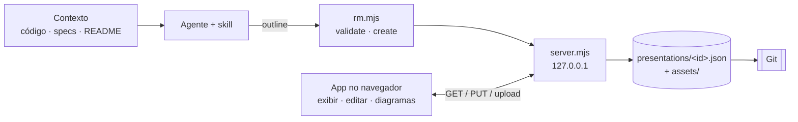

<div align="center">


<br>

[](https://github.com/p-oliveira7/context-maps/actions/workflows/ci.yml)
[](#começando)
[](#começando)
[](#segurança)
[](#skill-para-agentes)
[](LICENSE)
[](#imagens-diagramas-e-links)

**Português (BR)** · [English](README.md)

[Começando](#começando) · [Recursos](#recursos) · [Skill](#skill-para-agentes) · [Formato](#formato-dos-dados) · [API](#api-do-servidor) · [Testes](#testes) · [Changelog](CHANGELOG.md)

</div>

---

**Context Maps** é um app local para visualizar e editar apresentações em formato de mapa mental, mais uma
*skill* para agentes (Claude, Codex, Cursor) que lê o contexto de uma aplicação — código, specs, fluxos,
decisões — e publica o mapa pronto, com imagens, diagramas e links.

> Sem backend externo, sem CDN, sem dependências de runtime. Tudo roda em `127.0.0.1` e cada
> apresentação é um arquivo JSON que você versiona com Git.

<p align="center">
  <br>
  <sub>Do pedido ao mapa: a skill monta (comandos reais) e depois você explora, busca e edita.</sub>
</p>

<p align="center">
  
</p>

## Sumário

- [Por que Context Maps](#por-que-context-maps)
- [Como as peças se encaixam](#como-as-peças-se-encaixam)
- [Começando](#começando)
- [Recursos](#recursos) — [navegar](#navegar-e-ler) · [editar](#editar) · [diagramas](#imagens-diagramas-e-links) · [cliente de API](#cliente-de-api-tela-dividida) · [exportar](#exportar-importar-e-compartilhar) · [salvar como](#salvar-como-e-pastas)
- [Skill para agentes](#skill-para-agentes)
- [Formato dos dados](#formato-dos-dados) · [API do servidor](#api-do-servidor) · [Segurança](#segurança)
- [Testes](#testes) · [Regenerando as imagens](#regenerando-as-imagens)
- [Limitações conhecidas](#limitações-conhecidas) · [Licença](#licença) · [Terceiros](#terceiros) · [Origem](#origem)

## Por que Context Maps

Explicar um sistema costuma exigir três coisas que vivem em lugares diferentes: **o texto** (README,
specs), **os diagramas** (fluxos, arquitetura) e **as evidências** (prints, links). Um mapa mental junta
as três numa só superfície navegável: você começa pela visão geral e abre os ramos conforme a conversa.

| | |
| --- | --- |
| **Versionamento de graça** | Cada apresentação é um JSON pequeno: `git diff` mostra exatamente que ideia mudou. |
| **Sem conta, sem nuvem** | O conteúdo da sua arquitetura não sai da sua máquina. |
| **Legível por agentes** | O formato é pequeno e documentado ([`schema.md`](skills/context-maps/schema.md)); um CLI valida e publica outlines. |
| **Revisável e reproduzível** | Edite à mão no app ou peça à skill para regerar ou ampliar o mapa quando o sistema mudar. |

## Como as peças se encaixam



| Peça | O que é | Onde |
| --- | --- | --- |
| **App** | Visualizador e editor de mapas (HTML/CSS/ES modules) | `index.html`, `app.js`, `motion.js`, `model.js`, `store.js`, `styles.css` |
| **Servidor local** | Node sem pacotes: serve o app e grava as apresentações | `server.mjs` |
| **Apresentações** | Um JSON por mapa + pasta de imagens | `presentations/<id>.json`, `presentations/<id>/assets/` |
| **Skill** | Procedimento + CLI para agentes montarem mapas | `skills/context-maps/` ([guia](docs/skill.pt-BR.md)) |
| **Testes** | Modelo, navegador, cards, movimento, edição e skill | `tests/` |

## Começando

Requisitos: **Node 18+** (testado em Node 24). Nenhum `npm install` é necessário para usar o app.

```bash
node server.mjs          # ou: npm start
```

Abra <http://127.0.0.1:4173>. Na primeira execução o servidor cria a apresentação de demonstração em `presentations/`.

| Variável | Padrão | Uso |
| --- | --- | --- |
| `PORT` | `4173` | Porta do servidor |
| `PRESENTATIONS_DIR` | `./presentations` | Pasta da biblioteca principal |
| `CONTEXT_MAPS_CONFIG` | `./.context-maps.json` | Onde as pastas extras ficam registradas |
| `COLLECTIONS_DIR` | `./collections` | Coleções do cliente de API (formato Bruno); os segredos vão para `.secrets/` dentro dela |

> Sem o servidor (por exemplo `python -m http.server`), o app abre **somente em exibição**, com o mapa
> de demonstração embutido. Não abra o `index.html` por `file://` (usa módulos ES).

**Idioma:** a interface segue o idioma do navegador — português (BR) ou inglês (qualquer outro idioma cai no inglês). Acrescente `?lang=pt` ou `?lang=en` à URL para forçar um deles; a escolha fica guardada no navegador. O conteúdo das apresentações é seu e nunca é traduzido (o exemplo que acompanha o projeto está em português).

`presentations/cities-for-people.json` (em inglês) e `presentations/cidades-para-pessoas.json` (em português) acompanham o repositório e mostram **todos os recursos** num só
lugar: abra, expanda tudo e ligue o modo *Editar*. **As imagens e o GIF deste README usam a interface em inglês.**

## Recursos

### Navegar e ler

<p align="center">
  <br>
  <sub>Passar o mouse num card destaca a linha que chega até ele, o aumenta um pouco e revela o subtítulo.</sub>
</p>

- **Mover** arrastando o fundo (ou segurando o **botão do meio do mouse** em qualquer lugar); **rolar** dá zoom; os botões − / + e ⌗ (enquadrar) ficam no canto.
- **Clique no título** (ou Enter/Espaço) expande ou recolhe um ramo. Abrir anima os cards por 420 ms e destaca a conexão ao primeiro filho (respeita `prefers-reduced-motion`).
- **Vários cards raiz** nunca se sobrepõem: quando uma árvore aberta cobriria outra, quem estava **abaixo (ou à direita)** se afasta, então a ordem original é mantida, e volta à posição salva ao recolher.
- **Expandir tudo / Recolher tudo**, **Tela cheia** e **Modo texto** (leitura linear do mapa inteiro) ficam na barra inferior. Na **tela cheia** a interface sai da frente: o nome da apresentação e os botões somem e só aparecem quando o mouse chega perto do **topo** (nome e menu) ou da **base** (botões e zoom) da tela, deixando uma apresentação limpa.
- **Subtítulos** aparecem num pequeno painel sob o card **somente ao passar o mouse**.
- **Teclado:** Tab alcança todos os cards; na exibição **→** abre um ramo ou entra nele, **←** recolhe ou vai para o pai, **↑ ↓** andam entre irmãos, **Enter/Espaço** alternam, e a vista **desliza suavemente até o card focado**, mantendo o zoom. O mapa é exposto aos leitores de tela como uma árvore.
- **Toque:** um dedo move o mapa, **dois dedos fazem pinça para dar zoom** (e também movem).
- **Busca** (🔍 na barra inferior, **Ctrl+K** ou **/**) acha ideias pelo título ou subtítulo, sem diferenciar maiúsculas nem acentos; ao escolher um resultado, os ramos que o escondem se abrem e o mapa centraliza nele.

<p align="center">
  <br>
  <sub>A busca (Ctrl+K) lista as ideias encontradas com o caminho; ao escolher uma, os ramos que a escondem se abrem. (Imagens com a interface em inglês.)</sub>
</p>

<p align="center">
  <br>
  <sub>O modo texto transforma o mapa num roteiro linear, bom para ler, buscar e compartilhar.</sub>
</p>

### Imagens, diagramas e links

<p align="center">
  <br>
  <sub>Um card pode ter várias imagens e diagramas ao mesmo tempo, além de um ou mais links.</sub>
</p>

- **Imagens e diagramas** abrem em tela cheia; com várias mídias há setas ‹ › (ou ← →) e contador.
- **Links** aparecem como selo "🔗 N link(s)" abaixo do card: um link abre direto, vários abrem uma lista.
- **Diagramas** usam a sintaxe [Mermaid](https://mermaid.js.org/), editados no app com pré-visualização ao vivo. Um **diagrama de sequência** (`sequenceDiagram`) é desenhado pelo próprio Context Maps (os rótulos dimensionam as linhas de vida, cada seta e nota é endereçável, os erros dizem a linha); o que ele não suporta cai no Mermaid. Comece um diagrama novo pelo modelo *Fluxograma* ou *Diagrama de sequência*. Nos diagramas de sequência, **Editar visualmente** abre um editor completo: participantes e passos em listas, um canvas em que você clica para selecionar e **arrasta de uma linha de vida até outra para criar uma mensagem**, dois cliques num rótulo para renomear, um inspetor para cada propriedade, notas e blocos `loop`/`alt`/`opt`/`par` com ramos, reordenar pelos botões ou Alt+setas, uma vista em **Texto** do mesmo diagrama, zoom e desfazer/refazer ilimitado (Ctrl+Z / Ctrl+Y). Aplicar devolve o texto ao editor de diagramas.
- **OpenAPI / Swagger.** O menu do card tem **OpenAPI**: cole o YAML ou JSON de uma especificação (OpenAPI 3 ou Swagger 2), escolha um arquivo ou busque por URL, e o card ganha uma imagem de resumo (título, versão e endpoints nas cores do Swagger). Ao clicar, abre a documentação interativa (Swagger UI, embutido em `vendor/` e carregado só quando preciso) com o **Try it out** já ligado; as chamadas passam pelo servidor local como no API client (sem CORS, mesmos certificados). Com o API client aberto, a documentação abre ao lado dele. Escolha um **endpoint em foco** e o card o destaca (método, caminho, resumo, parâmetros e códigos de resposta), e a documentação já abre nele, expandido. No modo de edição, **Trocar** substitui a especificação ou o foco. É uma visualização: a especificação não é editada no app.

<p align="center">
  <br>
  <sub>O editor Mermaid: código à esquerda, pré-visualização ao vivo à direita.</sub>
</p>

### Editar

Ative o switch **Editar** na barra inferior. Passe o mouse num card e clique no botão **✎** no topo, ao
centro: abre uma **roda de ações** em volta dele (fecha com **Esc**, × ou clicando fora).

<p align="center">
  
</p>

| Ação | Como |
| --- | --- |
| Editar texto | Clique no texto; Enter confirma |
| Adicionar ideia | **+ Filho**, **+ Irmão** (depois), **+ Antes** (irmão antes) ou **+ Pai** (envolve a ideia num novo card pai); profundidade livre |
| Cards raiz | **Card raiz** (barra inferior) adiciona outro ponto de partida em qualquer lugar do mapa. Arraste uma raiz pela alça **⋮⋮** para posicioná-la livremente. **Virar raiz** na roda (ou soltar qualquer card no espaço vazio) transforma um ramo numa nova raiz |
| Nome da apresentação | **Duplo clique** no nome, no menu do canto superior esquerdo, para renomear (separado do texto dos cards raiz). Os nomes são únicos: um nome repetido é recusado, e *nova/cópia* acrescentam " (2)", " (3)"… |
| Imagens | **+ Imagem** (vários arquivos) ou **arraste arquivos de imagem para o card**; cada arquivo é **copiado** para `presentations/<id>/assets/` e o original não é alterado; **×** remove uma |
| Reordenar mídias | Com 2+ imagens/diagramas no card: **↑ ↓** ou arraste a alça **⋮⋮** (uma linha verde mostra onde cai) |
| Diagramas | **+ Diagrama** abre o editor Mermaid; **Editar** reabre |
| Cards sem título | Apague o título de um card que tenha imagem/diagrama ou subtítulo: ele passa a mostrar só esse conteúdo |
| Subtítulo · Links | Digite no campo "Subtítulo" abaixo do título; **+ Link** aceita http/https, com chips e **×** para remover |
| Duplicar · Copiar · Colar | Na roda: **Duplicar** clona uma ideia com tudo abaixo ao lado da original; **Copiar** a guarda e **Colar** (aparece depois de copiar) a adiciona como filha de outra ideia — inclusive em outra apresentação, copiando as imagens |
| Relacionar ideias | **Relacionar** na roda e depois clique em outra ideia: uma linha pontilhada liga as duas (nos dois sentidos) e um selo mostra quantas ideias estão relacionadas e leva a cada uma. Clique na mesma dupla de novo para remover |
| Desfazer / refazer | Botões **↶ ↷** na barra inferior, ou **Ctrl+Z** / **Ctrl+Shift+Z** (**Ctrl+Y**). Vale para qualquer edição, até 100 passos; digitar num campo conta como um passo só |
| Excluir | **Excluir** (pede confirmação se houver ideias abaixo) |

O **salvamento é automático** (o estado aparece ao lado do nome: *Salvo / Salvando… / Erro ao salvar*).

#### Ideias relacionadas

<p align="center">
  <br>
  <sub>Uma linha pontilhada liga as ideias relacionadas; passar o mouse numa delas destaca a linha, e o selo leva até a outra ideia.</sub>
</p>

#### Mover ideias arrastando

<p align="center">
  
</p>

Arraste a **alça ⋮⋮** à esquerda do card. O card e **tudo abaixo dele** saem do mapa e acompanham o cursor
como uma pequena árvore. Solte sobre outro card (vira filho) ou na borda de cima/baixo (vira irmão). Pairar
sobre um **ramo fechado o abre sozinho**, para você percorrer as ramificações. Segure o **botão do meio do
mouse** para mover o quadro durante o arraste, a roda dá zoom e **Esc** cancela; depois de cada movimento
aparece **Desfazer**.

#### Cor das ligações

<p align="center">
  
</p>

**Cor linhas** (na roda, em qualquer ideia com filhas) abre uma paleta. Escolha **Só filhos diretos** (as
linhas que saem daquele card) ou **Toda a ramificação abaixo**. O próprio card, as filhas e a linha que
chega até ele nunca mudam.

### Exportar, importar e compartilhar

- **Exportar como HTML…** baixa um único arquivo `.html` com o visualizador, o mapa e todas as imagens dentro. Ele abre offline em qualquer navegador, somente leitura — dá para mandar por e-mail ou anexar a um chamado.
- **Exportar como ZIP…** baixa os arquivos da apresentação: `<nome>.json` mais a pasta `<nome>/assets/` com as imagens. Descompacte numa pasta de um repositório (e use **Adicionar pasta…**) ou entregue a um colega.
- **Importar…** (no mesmo menu) lê um **pacote ZIP** ou um **HTML exportado** e abre o resultado como uma apresentação nova. Os nomes continuam únicos (um nome repetido ganha " (2)"), as imagens são copiadas para `presentations/<id>/assets/` e referências a arquivos que não estão no pacote são descartadas. Nada do arquivo é executado.

### Cliente de API (tela dividida)

<p align="center">
  <br>
  <sub>Mapa à esquerda, cliente de API à direita: o símbolo da API no card abre a lista da coleção anexada a ele.</sub>
</p>

O botão **API** na barra inferior divide a tela: o mapa fica à esquerda e abre à direita um **cliente no estilo Postman/Bruno** (arraste a borda, ou use as setas nela, para redimensionar).

- **Coleções no formato do Bruno.** Cada coleção é uma pasta em `collections/` (`bruno.json`, um arquivo `.bru` por request, pastas, `environments/*.bru`). É texto puro: versiona bem no Git e abre no [Bruno](https://www.usebruno.com/). Crie, importe (**⋯ › Importar**, um ZIP do Bruno) e exporte (ZIP) pelo painel.
- **Requests.** Método, URL (os parâmetros de consulta e de caminho `:id` ficam sincronizados com a URL), cabeçalhos, corpos (JSON, texto, XML, form URL-encoded), autenticação bearer e basic, variáveis da request e docs. As mudanças ficam na aba da request (marcada com um **●** e *Alterações não salvas*) e só vão para o arquivo `.bru` com **Ctrl+S** ou o botão **Salvar**; fechar uma aba, trocar de coleção, renomear uma request com alterações ou recarregar a página pergunta antes (*Salvar* / *Não salvar* / *Cancelar*). Enviar e executar uma pasta usam o que está aberto nas abas, salvo ou não. **Ctrl+Enter** envia.
- **Variáveis e ambientes.** Use `{{nome}}` em qualquer lugar (ordem: coleção < ambiente < variáveis da request) e também `{{$timestamp}}`, `{{$isoTimestamp}}`, `{{$guid}}` e `{{$randomInt}}`. A aba **Variáveis** mostra a request resolvida. Os ambientes se editam em ⚙; marque um valor como **Segredo** e ele fica só nesta máquina (`collections/.secrets/`, fora do Git) — nunca nos arquivos `.bru`, nas exportações ZIP nem no repositório.
- **Cores das variáveis.** Na URL, nos cabeçalhos, parâmetros, corpos e campos de autenticação, cada `{{variável}}` é destacada: **vermelha** quando ainda não tem valor, **verde** quando tem (azul para as embutidas, como `{{$timestamp}}`). **Passe o mouse** nela (ou use **Ctrl+.** com o cursor dentro) para ver o valor e de onde ele vem, e **edite ali mesmo**; para uma variável sem valor você escolhe onde guardar: o ambiente selecionado, esta request ou só esta sessão. Valores secretos aparecem mascarados (Mostrar revela) e as cores se atualizam ao trocar de ambiente.
- **Envio.** As requests passam pelo servidor local (sem limites de CORS; só `http`/`https`, 30 s de tempo limite, 10 MB de resposta). A resposta mostra status, tempo, tamanho, cabeçalhos e o corpo formatado.
- **Tokens JWT.** Todo valor que seja um JWT (com ou sem `Bearer`, `JWT` ou `Token` na frente) ganha um botão **JWT**: strings no corpo da resposta, cabeçalhos da resposta, variáveis de ambiente e da sessão, cabeçalhos da request como `Authorization: Bearer {{token}}` (as variáveis são resolvidas antes) e o campo Bearer da aba Auth. Com o API client aberto, o token abre por cima do painel, do tamanho dele. Ele abre o token decodificado com cabeçalho, payload, as principais claims e as datas por extenso (válido, expira em 50 minutos, expirado há 2 horas), com botões para copiar o token ou o payload. O token só é decodificado; a assinatura não é verificada.
- **Certificados (SSL/TLS).** As requests HTTPS confiam nos certificados do sistema operacional além da lista do próprio Node (no Node 22.19+ / 24.5+), então uma CA da empresa, como um proxy que inspeciona HTTPS, funciona sem configurar nada em qualquer máquina; use `CONTEXT_MAPS_SYSTEM_CA=0` para desligar. Se um servidor ainda falhar com `SELF_SIGNED_CERT_IN_CHAIN` ou parecido, o erro oferece **desligar a verificação de certificado SSL/TLS daquela coleção** (também no menu ⋯ e no menu de contexto da coleção). A escolha fica no `bruno.json` da coleção, então viaja com a pasta, o Git e o ZIP; um selo vermelho **SSL off** na linha da coleção religa a verificação. Em versões antigas do Node, inicie o servidor com `NODE_EXTRA_CA_CERTS=ca.pem`.
- **Scripts, testes e asserts.** A aba **Scripts** edita o script de pré-requisição, o de pós-resposta e os `tests`; a aba **Asserts** edita o bloco declarativo `assert` (`res.status eq 200`, `res.body.items length 3`, `res.headers.content-type contains json`… 30 operadores); a aba **Variáveis** também aceita variáveis pós-resposta (`token = res.body.token`). Tudo fica no arquivo `.bru`, então o Bruno executa igual. Os resultados aparecem na aba **Testes** (resumo de passou/falhou ao lado do status) e no **Console**.
- **Os scripts rodam num sandbox isolado.** Cada script roda numa moldura isolada (origem opaca, CSP `default-src 'none'`) dentro de um Worker que é interrompido após 5 s: **sem rede, sem armazenamento, sem acesso ao app nem aos seus dados**, então uma coleção importada não consegue ler nem vazar nada. Disponíveis: `bru` (`getVar`/`setVar`, `getEnvVar`/`setEnvVar`, `interpolate`, `sleep`…), `req` (`getUrl`/`setUrl`, `setHeader`, `setBody`…), `res` (`res.status`, `res.body`, `res('caminho')`…), `test`, `expect` (estilo Chai) e `require("chai")`. O script de pré-requisição roda antes de as `{{variáveis}}` serem resolvidas, então `bru.setVar` pode alimentar a mesma request. Indisponíveis: `bru.sendRequest`/`runRequest`, `axios`, `lodash` e outros módulos. A chave **Scripts** ao lado do Enviar desliga a execução dos scripts.
- **Reordene** requests e pastas arrastando na árvore.
- **Corpo da resposta.** O JSON vira uma árvore recolhível e colorida (clique numa chave para copiar o caminho, ex.: `res.body.items[0].id`, para asserts e variáveis); XML, HTML e SVG também têm cores; **Ctrl+F** busca no corpo (com contador, próximo/anterior, e ramos recolhidos abrem sozinhos); o **filtro por caminho** mostra só um valor (`items[0].id`, `res.status`); o **Preview** exibe imagens, SVG e HTML (o HTML roda numa moldura isolada: sem scripts e sem rede). *Formatado* / *Bruto* alternam a formatação, arrays grandes carregam 200 itens por vez e *Copiar* continua copiando tudo.
- **Janela de nova request.** Criar uma request (o **+** da árvore, o **+** de uma pasta ou o menu do botão direito) abre uma janela com duas formas de começar: *Do zero* (nome, método, URL) ou *Importar de um cURL* (cole o comando; método, URL, cabeçalhos, corpo e autenticação vêm junto). Ela mostra onde a request será criada, sugere um nome como `POST /orders` quando você deixa vazio, e abre a request nova numa aba.
- **cURL.** Cole um comando `curl …` (o *Copy as cURL* do navegador funciona) no campo de URL, ou digite e aperte Enter: ele vira a request inteira. *Copiar como…* (também no menu do botão direito) abre uma janela com o comando cURL ou `fetch` **inteiro** na tela, a troca de formato e uma caixa para trocar as `{{variáveis}}` pelos valores do ambiente (avisa das que continuam sem valor); *Copiar* copia exatamente o que você está vendo.
- **Variáveis sem valor.** Se uma request ainda tem `{{variáveis}}` sem valor, um aviso as nomeia e deixa escolher um ambiente ou editar os ambientes (o relatório de execução também mostra). Um botão `{x} N` no cabeçalho lista as variáveis de sessão definidas por scripts e variáveis pós-resposta, para editar, remover ou limpar.
- **Menu do botão direito.** Em requests, pastas e na coleção (também a tecla de menu, e o toque longo): abrir, duplicar, copiar como cURL/fetch, executar, nova request ou pasta, renomear, anexar, excluir. Em telas estreitas a lista de requests vira uma gaveta (☰).
- **Largura da lista.** Arraste o divisor entre a lista de coleções e pastas e o editor (ou use ← → Shift+← → Home End nele; duplo clique ou Enter volta ao padrão) e recolha a lista com ☰ para dar o painel todo ao editor. A largura e o estado recolhido ficam lembrados.
- **Abas.** Cada request aberta ganha uma aba, e dá para alternar entre elas sem perder nada: cada aba guarda a sua resposta, a sua aba interna e o que você editou, e um envio que ainda está rodando termina na própria aba. Feche com o **×**, o clique do meio ou **Delete**; **← → Home End** navegam entre as abas; as abas abertas voltam quando você reabre o painel. O relatório de execução também é uma aba.
- **Disposição do editor e da resposta.** Mostre a resposta abaixo do editor ou ao lado (◫ / ⬒), arraste o divisor ou use as setas nele, e use ⤢ para focar na resposta. A escolha fica lembrada.
- **Abrir request rápido.** **Ctrl+K** dentro do painel abre uma request digitando parte do nome, da URL, do método ou da pasta (↑ ↓ Enter); **Ctrl+S** salva a request da aba ativa e **Ctrl+Enter** envia.
- **Mocks.** A aba **Mock** dá a uma request respostas simuladas (modelos como 200, 401, 404, 500, timeout e erro de rede, ou uma capturada de uma resposta real) com status, headers, corpo e atraso, para mostrar um fluxo antes de o backend existir. A linha da coleção tem o botão **Modo mock** com o número de requests que vão responder com mock; requests, pastas e abas ganham o selo MOCK, e a resposta e o relatório do run indicam quando um mock respondeu. Os mocks são salvos junto com a request (Ctrl+S) em `mocks.json`, dentro da coleção.
- **Execute uma pasta.** Passe o mouse numa pasta (ou na coleção) e use **▶** para rodar as requests dela, ou **▶▶** para rodar com todas as subpastas, na ordem da árvore. As variáveis de sessão passam de uma request para a seguinte (faça o login uma vez e chame as requests protegidas). O relatório interativo tem uma barra de progresso com um trecho por request (clique para ir até ela), contagem de passou/falhou/erro, asserts e testes, tempo total, filtros, busca e um detalhe expansível de cada request com a URL enviada, as verificações, o corpo, os cabeçalhos e o console dos scripts. Dá para **parar** a execução, **parar na primeira falha**, definir um **intervalo** entre as requests, **executar de novo só as que falharam** ou uma só, abrir a request pelo relatório, **copiar um resumo** ou **exportar um relatório JSON** (sem corpos nem cabeçalhos).
- **Importe pastas do Bruno.** *Importar pasta do Bruno…* no menu ⋯ (ou soltar uma pasta no painel) lê uma pasta no formato do Bruno. Com `bruno.json` ela vira uma coleção nova, com os ambientes; uma pasta solta de arquivos `.bru` entra na coleção aberta (ou vira uma coleção nova). Pastas ocultas, `node_modules` e arquivos que não são do Bruno são ignorados, e valores secretos nunca vêm dos arquivos.

<p align="center">
  
  <br>
  <sub>Esquerda: as <code>{{variáveis}}</code> ficam vermelhas sem valor e verdes com valor; passe o mouse para ver e editar. Direita: asserts e testes de script na resposta.</sub>
</p>

**Anexar a um card.** Arraste uma coleção, uma pasta ou uma request avulsa do painel para um card (modo edição), ou abra a roda do card, escolha **API** e clique em ⤓ em uma delas. O card mostra só o símbolo da API (o mesmo do botão API do rodapé); clique nele para abrir um dropdown com a coleção ou pasta anexada e as pastas e requests dela, e clique em qualquer item para abrir o cliente **sem mudar o zoom nem o foco do mapa**, expande só a pasta anexada (ou a pasta da request anexada, selecionando a request) e destaca a linha de destino. O card guarda uma cópia salva da lista, então continua legível no modo texto e no HTML exportado (onde o dropdown só lista, já que não há servidor).

Uma coleção de exemplo, **Context Maps API**, acompanha o projeto em `collections/` e documenta a própria API do app (escolha o ambiente `local`).

<p align="center">
  <br>
  <sub>O menu de apresentações: salvar, exportar (HTML ou ZIP) e importar.</sub>
</p>

### Salvar como e pastas

<p align="center">
  
</p>

**Salvar como…** e **Salvar uma cópia…** (no menu de apresentações, ou **Ctrl+Shift+S**) abrem uma janela
onde você escolhe o **nome**, a **pasta** e o que acontece depois:

- **Pasta:** a biblioteca do app (`presentations/`), qualquer pasta registrada antes, ou **Outra pasta…** — digite o caminho completo ou clique em **Escolher…** (abre a janela nativa de pastas). A pasta é criada se preciso, lembrada em `.context-maps.json` (não versionado) e listada no menu, então você pode **abrir e editar apresentações no próprio lugar**, por exemplo dentro do repositório de outro projeto. **Adicionar pasta…** registra uma pasta que já tem apresentações; o **×** ao lado da pasta só a tira da lista (nenhum arquivo é apagado).
- **Depois de salvar:** *Abrir a nova apresentação* (padrão do *Salvar como*) ou *Continuar nesta* (padrão do *Salvar uma cópia*). O arquivo e as imagens são copiados juntos; os nomes continuam únicos.
- Em pastas extras, os caminhos das imagens são gravados **relativos ao arquivo** (`<nome>/assets/…`), então a pasta inteira é portátil.

## Skill para agentes

A skill transforma contexto em mapa. Resumo do fluxo (detalhes em [`docs/skill.pt-BR.md`](docs/skill.pt-BR.md)):

1. O agente garante o servidor: `node skills/context-maps/scripts/rm.mjs serve`.
2. Lê o contexto relevante (código, README, specs, diagramas existentes).
3. Escreve um **outline** em markdown:

   ```markdown
   # Fluxo de login [img:docs/capa.png|Capa]
   - Autenticar {color=#c76a61}
     - Validar credenciais [link:https://owasp.org/|OWASP]
     - Fluxo detalhado [mermaid:docs/login.mmd]
   - Sessão
     - Renovar token
   ```
4. Valida e publica:

   ```bash
   node skills/context-maps/scripts/rm.mjs validate --outline mapa.md
   node skills/context-maps/scripts/rm.mjs create   --outline mapa.md --id fluxo-login
   ```
5. Recebe a URL (`http://127.0.0.1:4173/?p=fluxo-login`), o arquivo gerado e um relatório (nós, mídias, itens pulados).

Exemplos de pedidos: *"mapa da arquitetura deste repositório"*, *"mapa dos fluxos de pagamento com os
diagramas do `docs/`"*, *"transforme esta especificação em um mapa para a reunião de amanhã"*.

**Cola rápida do outline**

| Marcador | Efeito |
| --- | --- |
| `# Título` | Um card raiz (várias linhas `#` criam várias raízes) |
| `- Título` (indentado) | Um card filho; a indentação define a profundidade |
| `[img:caminho\|alt]` | Anexa uma imagem local |
| `[mermaid:arquivo.mmd]` | Renderiza um arquivo Mermaid como diagrama (exige `mmdc`) |
| `[link:url\|rótulo]` | Adiciona um link |
| `[subtitle:texto]` | Texto de apoio exibido ao passar o mouse |
| `[rel:Título da ideia]` | Relaciona esta ideia a outra (ligação cruzada) pelo título exato |
| `{color=#hex}` · `{links=#hex}` | Cor do card · cor das linhas que saem do card |

Opções do CLI: `--id`, `--title`, `--replace`, `--dir <pasta>` (cria em outra pasta). Para atualizar um mapa depois que o sistema mudou, rode `update --id <slug> --outline mapa.md`: ele casa as ideias pelo título e mantém ids, cores, posições e edições manuais (`--dry-run` mostra o que mudaria, `--prune` remove ideias que saíram do outline). As mensagens seguem
`RM_LANG=en|pt`; `MMDC` / `MMDC_BROWSER` apontam para o mermaid-cli e seu navegador.

### Compatibilidade com agentes

| Agente | Como a skill é encontrada | Status |
| --- | --- | --- |
| **Claude (Claude Code)** | `skills/context-maps/SKILL.md` (copie para `~/.claude/skills/` para uso global) | Formato nativo |
| **Codex** | `AGENTS.md` na raiz aponta para o `SKILL.md` | Arquivos checados no CI; teste no app real pendente ([como verificar](docs/skill.pt-BR.md#codex-e-cursor)) |
| **Cursor** | `.cursor/rules/context-maps.mdc` e `AGENTS.md` | Arquivos checados no CI; teste no app real pendente ([como verificar](docs/skill.pt-BR.md#codex-e-cursor)) |

O trabalho pesado fica em um CLI Node (`rm.mjs`), então qualquer agente com acesso ao terminal consegue usar.
As instruções para agentes (`SKILL.md`, `schema.md`, `AGENTS.md`) estão em inglês, com cópias em português (`*.pt-BR.md`).

## Formato dos dados

```json
{
  "id": "meu-fluxo",
  "title": "Nome da apresentação",
  "roots": [{
    "id": "root",
    "title": "Primeiro card raiz",
    "x": 0, "y": 0,
    "children": [
      {
        "id": "n-1a2b3c4d",
        "title": "Ideia",
        "color": "#c76a61",
        "linksColor": "#ffffff",
        "subtitle": "Texto de apoio exibido ao passar o mouse",
        "images": [
          {"src": "presentations/meu-fluxo/assets/tela.png", "alt": "Tela inicial"},
          {"src": "presentations/meu-fluxo/assets/d.svg", "alt": "Diagrama", "kind": "diagram", "source": "flowchart TD…"}
        ],
        "links": [{"url": "https://exemplo.com/docs", "label": "Docs"}],
        "related": ["n-9f8e7d6c"],
        "children": []
      }
    ]
  }]
}
```

Referência completa e boas práticas de modelagem: [`skills/context-maps/schema.pt-BR.md`](skills/context-maps/schema.pt-BR.md).
O formato antigo `{id, tree}` ainda é lido e migrado ao salvar.

## API do servidor

Escuta apenas em `127.0.0.1`. Todas as rotas respondem JSON e `Cache-Control: no-store`.

| Método e rota | Função |
| --- | --- |
| `GET /api/presentations` | Lista (`id`, `title`, `updatedAt`) |
| `POST /api/presentations` | Cria (`{title, id?, dir?}`; `dir` = qualquer pasta absoluta) |
| `GET /api/presentations/:id` | Lê |
| `PUT /api/presentations/:id` | Salva `{title, roots}` (valida ids únicos, profundidade ≤ 40, mídias/links ≤ 50 por nó) |
| `POST /api/presentations/:id/copy` | Copia com um novo nome (`{title, dir?}`), incluindo as imagens, para a biblioteca ou outra pasta |
| `GET/POST /api/libraries`, `DELETE /api/libraries/:key` | Lista, adiciona ou esquece pastas extras |
| `POST /api/pick-folder` | Abre o seletor de pastas do sistema e devolve o caminho escolhido |
| `GET /api/presentations/:id/export?format=html\|zip` | Baixa a apresentação como um HTML único e autocontido ou como pacote ZIP |
| `GET/POST/DELETE /api/collections…` | Coleções no formato do Bruno: listar, criar, itens, requests, ambientes, exportar/importar ZIP (`/api/collections/import`), importar pasta (`/api/collections/import-folder`) |
| `POST /api/send` | Envia uma requisição HTTP a partir do servidor local (só `http`/`https`) para o cliente de API |
| `POST /api/import?name=…` | Importa um pacote ZIP ou um HTML exportado (corpo bruto) como uma apresentação nova |
| `DELETE /api/presentations/:id` | Remove o arquivo e as imagens |
| `POST /api/presentations/:id/assets?name=…` | Envia imagem (png, jpg, webp, gif, svg; até 15 MB) |

### Segurança

Toda requisição que altera algo precisa do cabeçalho `x-context-maps: 1` (outras páginas web não conseguem
enviá-lo ao seu servidor local) e o `Host` precisa ser local. Não há acesso a arquivos fora da pasta do app e
das bibliotecas registradas, só links http/https são aceitos e o Mermaid roda em `securityLevel: strict`. O `POST /api/send` (o proxy do cliente de API) tem a mesma proteção, mas lembre que ele alcança qualquer host que a sua máquina alcança — inclusive serviços em `localhost` — então use o app só numa máquina e rede de confiança. Já os scripts das coleções rodam num sandbox sem rede (veja acima).

## Testes

`npm test` roda os testes de modelo (Node, sem preparação). Os testes de navegador usam Playwright e o Chrome instalado:

```bash
npm install --no-save playwright-core   # uma vez; ou defina PLAYWRIGHT_MODULE para um playwright-core existente
npm run test:e2e                        # edit, skill, collections, sandbox, api, browser, cards, motion e a11y, com servidor temporário isolado
node tests/edit.mjs                     # ou rode uma suíte só
```

| Suíte | Cobre |
| --- | --- |
| `edit` EDIT-01..31 | edição, diagramas, mídias, links, pastas, idioma, exportação, importação |
| `skill` SKILL-01..09 | CLI da skill |
| `browser` MAP-01..13 | navegação, zoom, modo texto, mobile, tela cheia |
| `cards` CARD-01..06 | títulos, raiz, teclado, imagens |
| `motion` MOT-01..05 | animações e movimento reduzido |
| `sandbox` SBX-01..05 · `scripting` SCR-01..07 | sandbox dos scripts (sem rede, tempo limite), expect, asserts, pipeline da request |
| `collections` COLL-01..07 · `bru` BRU-01..05 | formato Bruno, API de coleções, segredos, ZIP |
| `api` API-01..13 | cliente em tela dividida, ambientes, envio, anexar a cards |
| `polish` POL-01..07 · `curl` | importar/copiar cURL, variáveis sem valor, menu de contexto, variáveis de sessão, telas estreitas |
| `response` RESP-01..10 | corpo da resposta: árvore JSON, copiar e filtrar por caminho, busca, cores XML/HTML, preview |
| `tabs` TAB-01..12 | abas de requests, disposição editor/resposta e divisor, abrir request rápido |
| `sequence` SEQ-01..09 · `sequence.test` · `sequence-edit.test` | diagramas de sequência nativos: leitura, layout, SVG, editor visual, operações de edição |
| `runner` RUN-01..12 · `runner.test` | executar pastas, relatório interativo, importar pasta do Bruno |
| `a11y` A11Y-01..07 | semântica de árvore, navegação por teclado, nomes acessíveis, foco nas janelas, zoom por pinça |

`BROWSER_EXECUTABLE` escolhe um binário específico do Chrome/Chromium. As mesmas verificações rodam em Linux,
macOS e Windows a cada pull request ([`.github/workflows/ci.yml`](.github/workflows/ci.yml)). Para rodar `browser`,
`cards` ou `motion` isoladamente, aponte `PREVIEW_URL` (padrão `http://127.0.0.1:4173`) para um servidor com `PRESENTATIONS_DIR` vazio ou temporário.

### Regenerando as imagens e a demo

As imagens em `docs/images/` vêm da apresentação de exemplo em inglês (`presentations/cities-for-people.json`, gerada a partir da versão em português por `docs/build-example-en.mjs`) e são reproduzíveis. O script copia
`presentations/` para uma pasta temporária, então seus arquivos não são tocados:

```bash
PLAYWRIGHT_MODULE=file:///caminho/para/playwright-core/index.mjs node docs/screenshots.mjs   # os PNGs
PLAYWRIGHT_MODULE=file:///caminho/para/playwright-core/index.mjs node docs/demo.mjs          # demo.gif (comandos reais da skill num servidor temporário)
```

`docs/demo.mjs` grava os quadros com o Playwright e codifica o GIF com `docs/gif.mjs`, um codificador pequeno e sem dependências.

## Limitações conhecidas

- A estrutura é uma **árvore**; as ideias podem ser **relacionadas** entre ramos (linhas pontilhadas), mas essas relações não têm setas nem rótulos.
- **Diagramas via CLI** exigem `mmdc` (mermaid-cli); no editor do app o Mermaid já vem embutido.
- URLs remotas de imagem **não são baixadas** pela skill (use arquivos locais).
- Remover uma mídia não apaga o arquivo em `assets/`.
- Uso pensado para **máquina local, usuário único**: não há autenticação nem edição simultânea.

## Licença

[MIT](LICENSE) © 2026 Paulo Oliveira.

## Terceiros

`vendor/mermaid.min.js` — [Mermaid](https://github.com/mermaid-js/mermaid) 12.2.0, licença MIT
(`vendor/mermaid.LICENSE`). Carregado sob demanda apenas pelo editor de diagramas.

## Origem

O comportamento do visualizador foi inspirado na observação de um visualizador de mapas mentais público.
Conteúdo, ilustrações, código e textos deste repositório são originais; nada da referência foi copiado.
